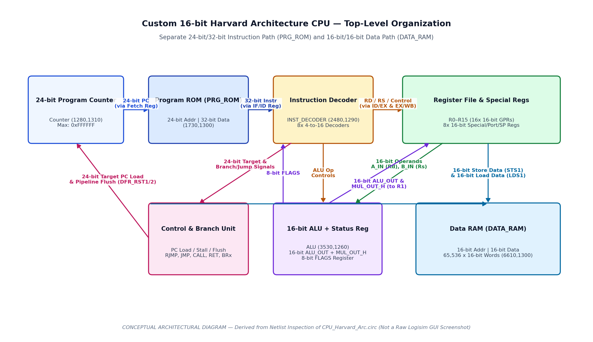
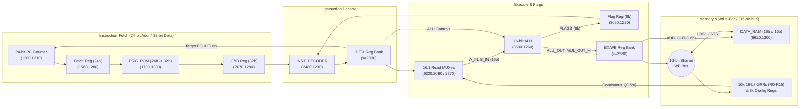
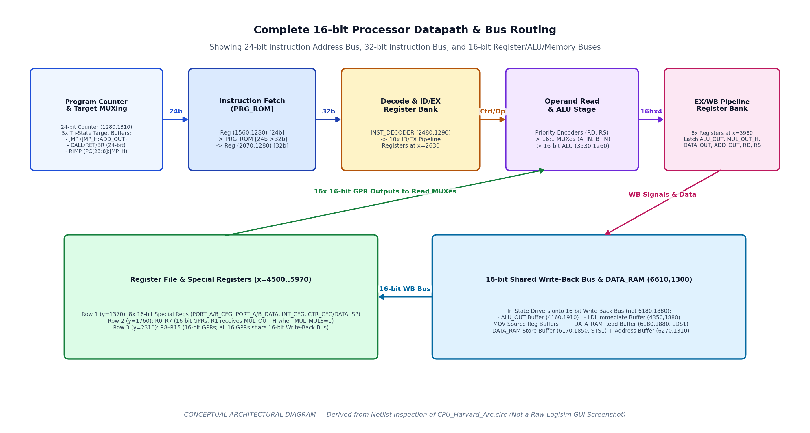
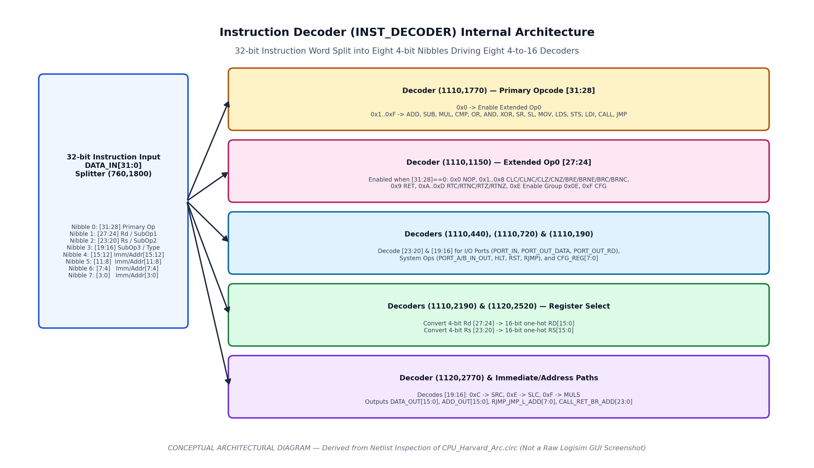
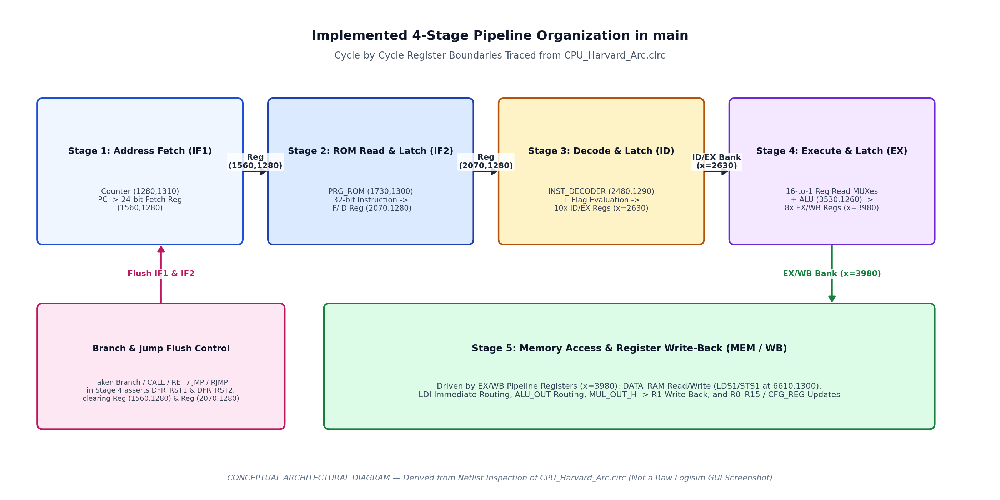

# Custom 16-bit Harvard Architecture CPU

**A custom processor implementation featuring a 32-bit instruction format, 16-bit data processing, a dedicated 16x16 array-multiplier ALU, a 4-stage pipeline register hierarchy, and custom instruction decoding, developed in Logisim Evolution.**

---

## Table of Contents

1. [Project Overview](#1-project-overview)
2. [Architecture Overview](#2-architecture-overview)
3. [Verified Hardware Specifications](#3-verified-hardware-specifications)
4. [Custom Instruction Set Architecture (ISA)](#4-custom-instruction-set-architecture-isa)
5. [Arithmetic Logic Unit (`ALU`) and Status Flags](#5-arithmetic-logic-unit-alu-and-status-flags)
6. [Datapath and Control Unit Interaction](#6-datapath-and-control-unit-interaction)
7. [Pipeline Organization and Hazard Handling](#7-pipeline-organization-and-hazard-handling)
8. [Memory Architecture (`PRG_ROM` and `DATA_RAM`)](#8-memory-architecture-prg_rom-and-data_ram)
9. [Instruction Execution Walkthroughs](#9-instruction-execution-walkthroughs)
10. [Running the Project in Logisim Evolution](#10-running-the-project-in-logisim-evolution)
11. [Verification Plan and Audit Summary](#11-verification-plan-and-audit-summary)
12. [Learning Outcomes](#12-learning-outcomes)
13. [Current Limitations and Future Improvements](#13-current-limitations-and-future-improvements)
14. [Repository Structure & GitHub Metadata](#14-repository-structure--github-metadata)
15. [Author](#15-author)

---

## 1. Project Overview

This repository presents the design, netlist-level architectural analysis, and technical documentation of a custom **16-bit Harvard Architecture CPU** implemented in **Logisim Evolution v4.1.0** ([`circuit/CPU_Harvard_Arc.circ`](circuit/CPU_Harvard_Arc.circ)). Developed as an academic computer architecture and digital logic design project while pursuing a **B.Sc. (Hons.) Electronics Science** degree at **Sri Venkateswara College, University of Delhi**, the processor explores digital system design from gate-level arithmetic up to pipelined instruction execution:

- **Pure Harvard Memory Organization**: Separate instruction memory (`PRG_ROM`, 24-bit word address, 32-bit instruction word) and data memory (`DATA_RAM`, 16-bit word address, 16-bit data word) with independent buses.
- **32-bit Fixed-Length Instruction Encoding with 16-bit Data Processing**: Eight 4-bit nibbles encode the primary opcode, destination/source registers, operation subtype, and a full 16-bit immediate constant or memory address in a single instruction word.
- **Gate-Level 16-bit ALU with 16x16 Combinational Array Multiplier**: Built from 256 AND gates and 256 1-bit full adders for 32-bit product generation (`ALU_OUT[15:0]` + `MUL_OUT_H[15:0]`), alongside a 16-bit ripple-carry adder/subtractor, 16-bit comparator, bitwise logic units, carry-linked barrel/splitter shifters, and an 8-bit status register.
- **Hardwired Combinational Decoder & Pipelined Datapath**: Eight 4-to-16 decoders inside `INST_DECODER` generate 48 control and operand signals that propagate across four inter-stage pipeline register banks (`IF1/IF2`, `IF2/ID`, `ID/EX`, `EX/WB`) with hardware branch/jump flushing (`DFR_RST1`, `DFR_RST2`).

---

## 2. Architecture Overview


*Figure 1: Conceptual top-level architecture of the Custom 16-bit Harvard CPU (generated from netlist inspection of `circuit/CPU_Harvard_Arc.circ`, not a raw Logisim screenshot).*



For a detailed analysis of bus width distinctions and Harvard vs. Von Neumann classification, see [`documentation/architecture.md`](documentation/architecture.md).

---

## 3. Verified Hardware Specifications

All parameters below have been verified directly from the XML component attributes and wire nets in [`circuit/CPU_Harvard_Arc.circ`](circuit/CPU_Harvard_Arc.circ):

| Parameter | Verified Specification | Circuit Evidence (`CPU_Harvard_Arc.circ`) |
| :--- | :--- | :--- |
| **Architecture Class** | **Pure Harvard Architecture** | Separate `PRG_ROM` `(1730,1300)` and `DATA_RAM` `(6610,1300)` buses |
| **Instruction Word Width** | **32 bits** | `PRG_ROM` `dataWidth="32"`, `IR (2070,1280)` `width="32"` |
| **Primary Data Path Width** | **16 bits** | `ALU_OUT`, `A_IN`, `B_IN`, `DATA_RAM`, and `R0`–`R15` all `width="16"` |
| **General-Purpose Registers** | **16 registers (`R0`–`R15`), 16 bits each** | `R0`–`R7` at `y=1760`, `R8`–`R15` at `y=2310` (`x=4500..5970`) |
| **Special / Config Registers** | **8 registers (`CFG_REG[0..7]`), 16 bits each** | `PORT_A_CFG`, `PORT_B_CFG`, `PORT_A_DATA`, `PORT_B_DATA`, `INTERRUPT_CFG`, `CTR_CFG`, `CTR_DATA`, `STACK_POINTER` at `y=1370` |
| **Program Counter (`PC`)** | **24-bit Up-Counter** (`0x000000`–`0xFFFFFF`) | `Counter (1280,1310)` `width="24"`, `max="0xffffff"` |
| **Program ROM (`PRG_ROM`)** | **24-bit Address, 32-bit Data** (word-addressed) | `ROM (1730,1300)` `addrWidth="24"`, `dataWidth="32"` (6 test words pre-loaded) |
| **Data RAM (`DATA_RAM`)** | **16-bit Address, 16-bit Data** (65,536 words) | `RAM (6610,1300)` `addrWidth="16"`, `dataWidth="16"` |
| **ALU Interface** | **Two 16-bit inputs (`A_IN`, `B_IN`), two 16-bit outputs (`ALU_OUT`, `MUL_OUT_H`), 8-bit status flags** | `ALU` subcircuit `(3530,1260)` (`615` components, `5,715` wires) |
| **Pipeline Organization** | **4 Inter-Stage Register Banks (5 Execution Phases: `IF1`, `IF2`, `ID`, `EX`, `MEM/WB`)** | `Reg (1560,1280)`, `Reg (2070,1280)`, 10x Regs at `x=2630`, 8x Regs at `x=3980` |
| **Implementation Tool** | **Logisim Evolution v4.1.0** | `<project source="4.1.0" version="1.0">` |

---

## 4. Custom Instruction Set Architecture (ISA)

The 32-bit instruction word is partitioned by Splitter `(760,1800)` in `INST_DECODER` into eight 4-bit nibbles:
- **Bits `[31:28]`**: Primary Opcode (`0x0`–`0xF`)
- **Bits `[27:24]`**: Destination Register `Rd` (`R0`–`R15`) or Extended Opcode `0x0` Subopcode (`0x0`–`0xF`)
- **Bits `[23:20]`**: Source Register `Rs` (`R0`–`R15`), `CFG_REG` index (`0..7`), or Upper Target `[23:20]`
- **Bits `[19:16]`**: Operation Subtype (`0xC` = `SRC`, `0xE` = `SLC`, `0xF` = `MULS`), System Subtype (`0x2` = `HLT`, `0x3` = `RST`, `0x4` = `RJMP`), or `JMP_H[7:4]`
- **Bits `[15:0]`**: 16-bit Immediate Constant (`DATA_OUT`) or 16-bit Memory/Branch Address (`ADD_OUT`)

| Primary Opcode | Mnemonic | Category | Summary of Operation |
| :---: | :--- | :--- | :--- |
| `0000` (`0x0`) | `NOP`, `CLC`..`CNZ`, `BRE`..`BRNC`, `RET`, `RTC`..`RTNZ`, `HLT`, `RST`, `RJMP`, `CFG` | Extended Control & System | Extended operations decoded via bits `[27:24]`, `[23:20]`, and `[19:16]` |
| `0001` (`0x1`) | **`ADD Rd, Rs`** | Arithmetic | `Rd <- Rd + Rs` (updates `CARRY_F`, `NEG_F`, `V_F`, `ZERO_F`, `H_F`) |
| `0010` (`0x2`) | **`SUB Rd, Rs`** | Arithmetic | `Rd <- Rd - Rs` (2's complement subtraction `Rd + ~Rs + 1`) |
| `0011` (`0x3`) | **`MUL Rd, Rs`** / **`MULS`** (`[19:16]=0xF`) | Arithmetic | 16x16 multiplication; low 16b -> `Rd`/`R1`, high 16b (`MUL_OUT_H`) -> `R0` |
| `0100` (`0x4`) | **`CMP Rd, Rs`** | Comparison | Sets `CMP_F = 1` if `Rd == Rs` (also writes `Rd - Rs` to `Rd` in current wiring) |
| `0101` (`0x5`) | **`OR Rd, Rs`** | Logical | `Rd <- Rd \| Rs` |
| `0110` (`0x6`) | **`AND Rd, Rs`** | Logical | `Rd <- Rd & Rs` |
| `0111` (`0x7`) | **`XOR Rd, Rs`** | Logical | `Rd <- Rd ^ Rs` |
| `1000` (`0x8`) | **`SR Rd`** / **`SRC Rd`** (`[19:16]=0xC`) | Shift / Rotate | 1-bit shift/rotate right (`SRC` updates `CARRY_F`) |
| `1001` (`0x9`) | **`SL Rd`** / **`SLC Rd`** (`[19:16]=0xE`) | Shift / Rotate | 1-bit shift/rotate left (`SLC` carry variant) |
| `1010` (`0xA`) | **`MOV Rd, Rs`** | Data Transfer | `Rd <- Rs` via shared 16-bit write-back bus |
| `1011` (`0xB`) | **`LDS Rd, Addr16`** | Memory Load | `Rd <- DATA_RAM[Addr16]` |
| `1100` (`0xC`) | **`STS Rs, Addr16`** | Memory Store | `DATA_RAM[Addr16] <- Rs` (`Rs` encoded in `[23:20]`) |
| `1101` (`0xD`) | **`LDI Rd, Imm16`** | Immediate Load | `Rd <- Imm16` |
| `1110` (`0xE`) | **`CALL Addr24`** *(Handwritten: `RJMP`)* | Control Flow | Unconditional 24-bit jump/call; flushes `IF1` and `IF2` |
| `1111` (`0xF`) | **`JMP Addr24`** | Control Flow | Unconditional 24-bit jump (`JMP_H` + `ADD_OUT`); flushes `IF1` and `IF2` |

Full bit-level tables, discrepancies between the handwritten notes and circuit, and worked hex encodings are documented in [`documentation/instruction-set.md`](documentation/instruction-set.md).

---

## 5. Arithmetic Logic Unit (`ALU`) and Status Flags

The `ALU` subcircuit (`3530,1260`) computes eight functional operations in parallel and selects the active 16-bit result via an **8-to-3 Priority Encoder** (`11760,6980`) driving an **8-to-1 Multiplexer** (`12330,6980`):
- **16x16 Combinational Array Multiplier**: 256 AND gates and 256 1-bit full adders compute a 32-bit unsigned product (`MUL_OUT_H[15:0]` and `MUX[0]`), with a sign-XOR multiplexer (`4020,6120`) on `MUL_OUT_H[15]` controlled by `MULS`.
- **16-bit Ripple-Carry Adder/Subtractor**: Sixteen 1-bit full adders (`12380,7560..8460`) with `B_IN ^ SUB` XOR gates and carry-in tied to `SUB`.
- **8-bit Status Flag Register (`13000,6730`)**: Latches `CARRY_F` (bit 0), `NEG_F` (bit 1, `ALU_OUT[15]`), `CMP_F` (bit 2, `A_IN == B_IN`), `V_F` (bit 3, `Adder_C14`), `ZERO_F` (bit 4, `ALU_OUT == 0`), `H_F` (bit 5, `Adder_C7`), `T_F` (bit 6), and `INT_F` (bit 7).

See [`documentation/alu.md`](documentation/alu.md) for the complete internal schematic breakdown and flag truth tables.

---

## 6. Datapath and Control Unit Interaction


*Figure 2: Processor datapath and bus organization.*


*Figure 3: `INST_DECODER` internal structure.*

Detailed component tables and signal traces are provided in [`documentation/datapath.md`](documentation/datapath.md) and [`documentation/control-unit.md`](documentation/control-unit.md).

---

## 7. Pipeline Organization and Hazard Handling


*Figure 4: Four-stage pipeline register organization (`IF1`, `IF2`, `ID`, `EX`, `MEM/WB`).*

- **Implemented Hardware Branch/Jump Flushing**: When `JMP`, `CALL`, `RET`, or a taken conditional branch reaches Stage 3 (`ID/EX`), `CTR_STP1` asserts `DFR_RST1` and `DFR_RST2`, flushing Fetch Register `(1560,1280)` and Instruction Register `(2070,1280)` while loading the 24-bit target into the Program Counter.
- **Software-Managed RAW Data Hazards**: Because the circuit does not include forwarding multiplexers from `EX/WB` back to the ALU input multiplexers, a two-instruction delay (two `NOP`s) is required when an instruction reads a register written by the immediately preceding instruction.

See [`documentation/pipeline.md`](documentation/pipeline.md) for complete timing diagrams and hazard analysis.

---

## 8. Memory Architecture (`PRG_ROM` and `DATA_RAM`)

- **Instruction Memory (`PRG_ROM` at `1730,1300`)**: 24-bit word-addressed ROM outputting 32-bit instruction words. Pre-loaded with the 6-instruction baseline loop (`d0000001 d1000001 10100000 c0100001 b2000000 f0000001`).
- **Data Memory (`DATA_RAM` at `6610,1300`)**: 16-bit word-addressed RAM ($65,536 	imes 16	ext{ bits}$) accessed in Stage 5 via `LDS1` (read enable) and `STS1` (write enable) using the 16-bit `ADD_OUT` address field.

See [`documentation/memory-architecture.md`](documentation/memory-architecture.md) for full memory timing and bus-bridging details.

---

## 9. Instruction Execution Walkthroughs

### 9.1 Arithmetic Execution (`ADD Rd, Rs` — e.g., `0x10100000`)
1. **Phase 1 (`IF1`)**: The 24-bit address in `Counter (1280,1310)` is latched into Fetch Register `(1560,1280)` on the rising edge of `CLK`.
2. **Phase 2 (`IF2`)**: `PRG_ROM (1730,1300)` looks up the 32-bit word `0x10100000`, which is latched into Instruction Register `(2070,1280)`.
3. **Phase 3 (`ID`)**: `INST_DECODER (2480,1290)` decodes `[31:28]=0x1` (`ADD=1`), `[27:24]=0x0` (`RD[0]=1`), and `[23:20]=0x1` (`RS[1]=1`). These signals are latched into ID/EX Registers `(2630,1750)` and `(2630,2080)`.
4. **Phase 4 (`EX`)**: Priority Encoders `(6440,2170)` and `(6440,2360)` convert `RD` (`0`) and `RS` (`1`) into 4-bit selectors for 16:1 MUXes `(6320,2090)` and `(6320,2270)`, routing `R0` to `A_IN` and `R1` to `B_IN`. Inside `ALU (3530,1260)`, `SUM=1` selects the 16-bit ripple-carry adder (`MUX[7]`). At the rising edge of `CLK`, `ALU_OUT` is latched into EX/WB Register `(3980,1860)`, `RD` into `(3980,1640)`, and the new status flags into `ALU` Flag Register `(13000,6730)`.
5. **Phase 5 (`WB`)**: Controlled Buffer `(4160,1910)` drives `ALU_OUT` onto the shared 16-bit Write-Back Bus (`net 6180,1880`). `RD[0]` enables `R0 (4500,1760)` via Buffer `(4480,1790)`, latching the sum `R0 + R1` into `R0` on the rising clock edge.

### 9.2 Memory Access Execution (`LDS Rd, Addr16` and `STS Rs, Addr16`)
- **`LDS Rd, Addr16` (`0xB2000000`)**:
  - Phases 1–3 decode `LDS=1`, `RD` (`[27:24]`), and 16-bit `ADD_OUT` (`[15:0]`).
  - Phase 4 routes `RD` through Buffer `(3780,1630)` into `(3980,1640)`, `LDS` into `(3980,1750)` (`LDS1`), and `ADD_OUT` into `(3980,2080)`.
  - Phase 5 (`MEM/WB`) asserts `LDS1=1`, enabling Address Buffer `(6270,1310)` (`ADD_OUT -> DATA_RAM.A`), asserting `DATA_RAM.OE`, and enabling Read Buffer `(6180,1880)` so the 16-bit word read from `DATA_RAM` drives the Write-Back Bus and is latched into `Rd`.
- **`STS Rs, Addr16` (`0xC0100001`)**:
  - Phases 1–3 decode `STS=1`, `RS` (`[23:20]`), and 16-bit `ADD_OUT` (`[15:0]`).
  - Phase 4 routes `RS` through Buffer `(3780,2070)` into `(3980,1970)`, `STS` into `(3980,1750)` (`STS1`), and `ADD_OUT` into `(3980,2080)`.
  - Phase 5 (`MEM/WB`) enables the tri-state output buffer of register `Rs` onto the shared Write-Back Bus, while `STS1=1` enables Store Buffer `(6170,1850)` (`WB Bus -> DATA_RAM.D_in`), Address Buffer `(6270,1310)` (`ADD_OUT -> DATA_RAM.A`), and `DATA_RAM.WE` (`6610,1350`), writing `Rs` into `DATA_RAM[ADD_OUT]` on the rising clock edge.

### 9.3 Control-Flow Execution (`JMP` and `RJMP`)
- **`JMP Addr24` (`0xF0000001`)**:
  - In `INST_DECODER`, `[31:28]=0xF` asserts `JMP` and enables Buffer `(1340,2880)` to output `RJMP_JMP_L_ADD[7:0]` (`JMP_H`) alongside `ADD_OUT[15:0]`.
  - In Phase 4 (`Stage 3` outputs), `JMP=1` enables 24-bit Buffer `(2870,2660)` to pass the 24-bit target (`{JMP_H, ADD_OUT}`) into Feedback Register `(2630,2640)`, while OR gate `(2790,2460)` latches `CTR_STP1=1` into `(2630,2450)`.
  - In Phase 5, `CTR_STP1` asserts `DFR_RST1` and `DFR_RST2` (flushing `IF1` and `IF2` registers `(1560,1280)` and `(2070,1280)`), while Buffer `(1160,1420)` and `(1200,1420)` drive the 24-bit target into `Counter (1280,1310)` (`load=1`) and Fetch Register `(1560,1280)`.

### 9.4 Multiplication Execution (`MUL` and `MULS`)
- **`MUL Rd, Rs` (`0x32300000`)**:
  - In Phase 4 (`EX`), `A_IN` (`Rd`) and `B_IN` (`Rs`) enter the 16x16 combinational array multiplier inside `ALU`.
  - The lower 16 bits of the product (`Product[15:0]`) exit `ALU_OUT` (`MUX[0]`) and are latched into EX/WB Register `(3980,1860)`.
  - The upper 16 bits (`Product[31:16]`) exit `MUL_OUT_H` (`13240,6240`) and are latched into EX/WB Register `(3980,1520)`.
  - Simultaneously, `OR Gate (3200,1310)` asserts `MUL_MULS=1`, which is latched into `(3980,1750)` bit 5.
  - In Phase 5 (`WB`), `ALU_OUT` (low 16 bits) is driven onto the shared Write-Back Bus and written into `Rd` (and `R1` via OR gate `4700,1730`), while `MUL_OUT_H` (high 16 bits) is driven through Controlled Buffer `(4490,1770)` directly into `R0` (`4500,1760`).

---

## 10. Running the Project in Logisim Evolution

1. **Clone or Download the Repository**:
   ```bash
   git clone https://github.com/<your-username>/16-bit-Harvard-RISC-CPU.git
   cd 16-bit-Harvard-RISC-CPU
   ```
2. **Launch Logisim Evolution**:
   - Install **Logisim Evolution v4.1.0** (or v3.8+ with Java 17+).
   - Open [`circuit/CPU_Harvard_Arc.circ`](circuit/CPU_Harvard_Arc.circ).
   - *Note*: If Logisim prompts for `ARRAY_MUL.circ` (declared on line 16 of the XML file), you may safely cancel or remove that `<lib>` line in a working copy; zero components in the file use `lib="13"`.
3. **Navigate the Four Subcircuits**:
   - **`main`**: Top-level CPU datapath, pipeline registers, `PRG_ROM`, `DATA_RAM`, and register banks.
   - **`ALU`**: 16-bit arithmetic, logic, shift, array multiplier, and status flag register.
   - **`INST_DECODER`**: 32-bit instruction word decoder (`8x` 4-to-16 decoders).
   - **`test`**: Auxiliary component test scratchpad (Counter, RAM, Hex Displays, TTY).
4. **Operate Clock and Reset Controls**:
   - Use **Simulate -> Reset Simulation (`Ctrl+R`)** to clear all registers and memory.
   - Use **Simulate -> Tick Full Cycle (`Ctrl+T` twice)** or Poke the `Clock` at `(1200,1060)` in `main` to step instructions through the 5 pipeline phases.
5. **Inspect Internal Signals**:
   - View `R0`–`R15` directly in the register boxes at `x=4500..5970` (`y=1760` and `y=2310`) or on the 64-bit tunnels `REG_0_1_2_3` .. `REG_12_13_14_15` (`6270,2400..2490`).
   - Right-click `PRG_ROM (1730,1300)` or `DATA_RAM (6610,1300)` and choose **Edit Contents...** to inspect or modify instructions and data.

---

## 11. Verification Plan and Audit Summary

A complete test matrix covering arithmetic, logical, shift, register/memory, control-flow, and status-flag edge cases is provided in [`documentation/verification.md`](documentation/verification.md), and ready-to-load hex programs are provided in [`programs/README.md`](programs/README.md).

### Final Implementation Audit

| Audit Category | Summary of Findings |
| :--- | :--- |
| **1. Verified from `CPU_Harvard_Arc.circ` Netlist** | - Pure Harvard organization with 24-bit addr / 32-bit data `PRG_ROM` `(1730,1300)` and 16-bit addr / 16-bit data `DATA_RAM` `(6610,1300)`.<br>- 16 general-purpose 16-bit registers (`R0`–`R15`) + 8 special 16-bit configuration registers (`PORT_A/B_CFG`, `PORT_A/B_DATA`, `INTERRUPT_CFG`, `CTR_CFG`, `CTR_DATA`, `STACK_POINTER`).<br>- 4 inter-stage pipeline register boundaries (`IF1/IF2` at `1560,1280`, `IF2/ID` at `2070,1280`, `ID/EX` bank at `x=2630`, `EX/WB` bank at `x=3980`).<br>- 16x16 combinational array multiplier (`256` AND gates + `256` 1-bit full adders) inside `ALU` producing 32-bit product (`MUL_OUT_H[15:0]` + `ALU_OUT[15:0]`).<br>- 8-bit status register (`CARRY_F`, `NEG_F`, `CMP_F`, `V_F`, `ZERO_F`, `H_F`, `T_F`, `INT_F`) and hardware branch/jump flush (`DFR_RST1`, `DFR_RST2`). |
| **2. Inferred from Circuit Structure** | - Intended signed multiplication (`MULS`) sign-bit XOR logic (`5420,550` -> `4020,6120`) on `MUL_OUT_H[15]`.<br>- Intended I/O port instructions (`PORT_IN`, `PORT_OUT_DATA`, `PORT_OUT_RD`, `PORT_A_IN_OUT`, `PORT_B_IN_OUT`) decoded in `INST_DECODER` and paired with `PORT_A/B` configuration registers in `main`. |
| **3. Unverified / Pending Interactive Simulation** | - Runtime waveform execution of the 23 test cases in [`documentation/verification.md`](documentation/verification.md) inside the Logisim Evolution GUI (marked `Not yet tested`).<br>- Visual verification of the author's original handwritten ISA specification pages (Sources B and C), which were transcribed in the project specification prompt. |
| **4. Discrepancies Between ISA Notes and Circuit** | 1. **Opcode `1110` (`0xE`)**: Handwritten notes list `1110` as `RJMP`; in `INST_DECODER`, `1110` is `CALL` (`1890,1890`), while `RJMP` (`1890,980`) is decoded under `0000 -> 1110 -> [0..2] -> 0100` (`0x0E04xxxx`), and the `RJMP` tunnel (`3050,2370`) in `main` is a single unconnected stub.<br>2. **Splitter `(760,1800)` Bit 6**: `bit6` is unassigned (`none`) in `INST_DECODER`, causing bit 6 (`0x0040`) of 16-bit immediates (`DATA_OUT`) and RAM addresses (`ADD_OUT`) to be pulled to `0`.<br>3. **`SUB` Priority Encoder Wiring in `ALU`**: `SUB` (`11670,7080`) drives the adder's `B_IN` XOR gates and `Cin`, but is not wired to input `7` of Priority Encoder `(11760,6980)` (only `SUM` is wired to input `7`).<br>4. **`SR` / `SL` Swap & `SL` Write-Back**: Splitter `(2980,1650)` in `main` swaps `SR` (`bit7 -> L_SFT`) and `SL` (`bit8 -> R_SFT`), and `SL` is omitted from the Stage 3 `RD` write-back OR gate `(3190,1740)`.<br>5. **`STS` Register Field**: `STS` (`0xC`) decodes its source register from `Rs` (`[23:20]`) rather than `Rd` (`[27:24]`).<br>6. **`CMP` Write-Back**: `CMP` is connected to the `ALU_EN` / register write-back OR gate `(3190,1740)`, so `CMP Rd, Rs` writes `Rd - Rs` into `Rd` in addition to updating `CMP_F`.<br>7. **`FLAGS` Bit Reversal in `main`**: Splitter `(3550,1270)` reverses the bit order of the 8 status flags relative to `INST_DECODER` Splitter `(1280,870)`, so conditional branches on Carry (`CLC`, `BRC`, `RTC`) test `FLAGS_IN[7]` and conditional branches on Zero (`CLZ`, `BRE`, `RTZ`) test `FLAGS_IN[3]`. |

---

## 12. Learning Outcomes

Completing and analyzing this processor demonstrates practical undergraduate competency across:
- **Computer Architecture**: Pure Harvard bus separation, fixed-width 32-bit instruction encoding vs. 16-bit data path sizing, word-addressed memory organization, and multi-stage pipeline register design.
- **Digital Logic & Datapath Engineering**: Gate-level 16x16 combinational array multiplier construction, ripple-carry addition/subtraction, priority-encoded multiplexer trees, and tri-state bus arbitration.
- **Control Unit & Pipeline Verification**: Hierarchical 4-to-16 instruction decoding, conditional branch gating, hardware pipeline flushing (`DFR_RST1`/`DFR_RST2`), and systematic netlist auditing.

---

## 13. Current Limitations and Future Improvements

### Current Implementation Limitations
1. **No Hardware Data Forwarding or Hazard Stall Unit**: Dependent instructions require 2 `NOP` cycles between write-back and operand read.
2. **Hardware Wiring Quirks Identified in Audit**: Unassigned `bit6` in Splitter `(760,1800)`, `SUB` missing from Priority Encoder input 7 in `ALU`, `SR`/`SL` splitter swap at `(2980,1650)`, and `CALL`/`RET` lacking hardware Stack Pointer (`5970,1370`) push/pop logic.
3. **Unused External Library Tag**: `CPU_Harvard_Arc.circ` contains an unused `<lib desc="file#ARRAY_MUL.circ" name="13"/>` header line.

### Proposed Future Extensions (Not Currently Implemented)
- **Hardware Forwarding & Hazard Detection Unit**: Add bypass multiplexers from Stage 4 (`ALU_OUT`) and Stage 5 (`WB Bus`) to `A_IN`/`B_IN` to eliminate the 2-cycle RAW delay.
- **Python Assembler & Automated Testbench**: Build a two-pass Python assembler that translates assembly mnemonics into Logisim `v2.0 raw` hex images and automates regression testing via Logisim CLI.
- **Hardware Stack Push/Pop for `CALL` and `RET`**: Connect the existing `STACK_POINTER` register (`5970,1370`) to a return-address stack or `DATA_RAM` auto-increment/decrement path.
- **Verilog / SystemVerilog RTL Port & FPGA Synthesis**: Translate the verified datapath, `INST_DECODER`, and `ALU` into synthesizable Verilog HDL for FPGA validation.

---

## 14. Repository Structure & GitHub Metadata

```text
16-bit-Harvard-RISC-CPU/
├── README.md                              # Main project entry point and executive overview
├── LICENSE                                # Recommended MIT License (confirm before publishing)
├── .gitignore                             # Ignores Logisim backup/temp files while preserving assets
├── circuit/
│   ├── CPU_Harvard_Arc.circ               # Original, unmodified Logisim Evolution v4.1.0 circuit
│   └── README.md                          # Subcircuit inventory and ARRAY_MUL.circ library note
├── documentation/
│   ├── architecture.md                    # Harvard classification and bus/memory width distinctions
│   ├── instruction-set.md                 # Complete 32-bit ISA reference, subtypes, and hex examples
│   ├── datapath.md                        # Register file, multiplexers, tri-state WB bus, and PC logic
│   ├── alu.md                             # 16x16 array multiplier, adder, shifters, and 8-bit flags
│   ├── control-unit.md                    # INST_DECODER 8-decoder tree and control signal table
│   ├── pipeline.md                        # 4-stage pipeline register boundaries and hazard analysis
│   ├── memory-architecture.md             # PRG_ROM (24b/32b) and DATA_RAM (16b/16b) organization
│   └── verification.md                    # Reproducible Logisim test plan and 28 test vectors
├── images/
│   ├── cpu-overview.png                   # Conceptual top-level architecture diagram
│   ├── datapath.png                       # Conceptual datapath and bus routing diagram
│   ├── alu.png                            # Conceptual ALU internal architecture diagram
│   ├── instruction-decoder.png            # Conceptual INST_DECODER diagram
│   └── pipeline.png                       # Conceptual 4-stage pipeline diagram
└── programs/
    └── README.md                          # Assemble-by-hand hex sample programs for PRG_ROM
```

### Suggested GitHub Repository Metadata
- **Repository Name**: `16-bit-Harvard-RISC-CPU`
- **Short Description**: `A custom 16-bit Harvard architecture CPU with a 32-bit instruction set implemented in Logisim Evolution, featuring a 4-stage pipeline, gate-level 16x16 array multiplier ALU, and custom instruction decoder.`
- **Suggested Topics**: `computer-architecture`, `harvard-architecture`, `risc-processor`, `cpu-design`, `digital-logic-design`, `logisim`, `logisim-evolution`, `instruction-set-architecture`, `alu`, `processor-design`
- **Licensing Recommendation**: The **MIT License** (included as a template in [`LICENSE`](LICENSE)) is recommended for academic hardware and portfolio repositories because it allows recruiters, faculty, and fellow students to inspect, simulate, and build upon the design with attribution. Confirm your institution's and personal licensing preference before publishing.

### Pre-Publication Checklist
- [x] Original `CPU_Harvard_Arc.circ` preserved without logic modifications in `circuit/CPU_Harvard_Arc.circ`.
- [x] Academic background accurately stated as **B.Sc. (Hons.) Electronics Science, Sri Venkateswara College, University of Delhi**.
- [x] Every bus width, register count, and memory parameter verified against `CPU_Harvard_Arc.circ`.
- [x] Conceptual diagrams in `images/` clearly labeled to distinguish them from raw Logisim GUI screenshots.
- [x] All internal relative Markdown links verified to point to existing files.
- [ ] Run interactive simulation in Logisim Evolution GUI to fill in the `Observed Result` column in `documentation/verification.md`.
- [ ] Replace placeholder author links in Section 15 below with your personal GitHub and LinkedIn URLs before pushing to GitHub.

---

## 15. Author

- **Author**: Undergraduate Student, **B.Sc. (Hons.) Electronics Science**
- **Institution**: **Sri Venkateswara College, University of Delhi**, New Delhi, India
- **GitHub**: `<Add your GitHub profile URL>`
- **LinkedIn**: `<Add your LinkedIn profile URL>`
