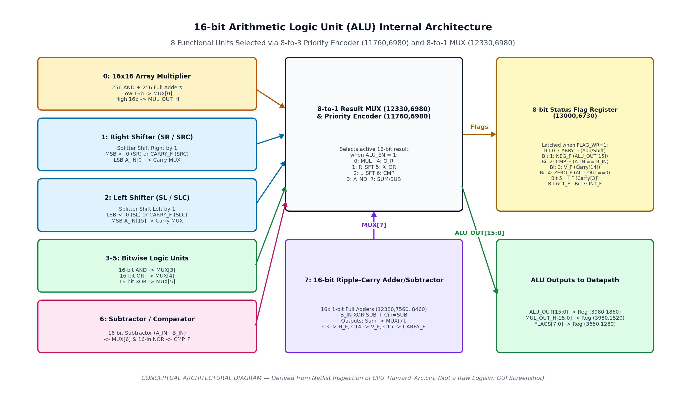

# Arithmetic Logic Unit (`ALU`) and Status Flags

## 1. Overview and Subcircuit Interface

The dedicated `ALU` subcircuit (instantiated in `main` at `(3530,1260)`) contains **615 components** and **5,715 wire segments**. It performs all 16-bit arithmetic, logical, shift/rotate, and comparison operations, and houses the primary 8-bit status flag register (`13000,6730`).

*Figure 1: Conceptual block diagram of the `ALU` subcircuit derived from `CPU_Harvard_Arc.circ`.*

### Verified `ALU` Pin Interface

| Pin Name | Direction | Width | Location in `ALU` | Connected Signal in `main` | Function |
| :--- | :---: | :---: | :---: | :--- | :--- |
| **`A_IN`** | Input | 16 bits | `(11670,7360)` | `Tunnel: A_IN` (`6320,2090` MUX) | Primary 16-bit operand (selected by destination register `Rd`) |
| **`B_IN`** | Input | 16 bits | `(11670,7400)` | `Tunnel: B_IN` (`6320,2270` MUX) | Secondary 16-bit operand (selected by source register `Rs`) |
| **`SUM`** | Input | 1 bit | `(11670,7060)` | `ADD \| MULS` (`3080,1360` OR) | Selects 16-bit addition (`MUX[7]`) and enables adder carry-out to `CARRY_F` |
| **`SUB`** | Input | 1 bit | `(11670,7080)` | `SUB \| SLC` (`3060,1310` wire-OR) | Selects 2's complement subtraction (`A_IN + ~B_IN + 1`) on the 16-bit adder chain |
| **`MUL`** | Input | 1 bit | `(11670,6920)` | `MUL` (`3000,1480`) | Selects low 16-bit product (`MUX[0]`) from the 16x16 array multiplier |
| **`MULS`** | Input | 1 bit | `(11670,6810)` | `MULS` (`3000,1300`) | Selects `A_IN[15] ^ B_IN[15]` on `MUL_OUT_H[15]` via MUX `(4020,6120)` |
| **`MUL_EN`** | Input | 1 bit | `(11670,6790)` | `Constant 0x1` (`3280,1360`) | Permanently `1` in `main`; enables tri-state buffers `(11810,6070)` and `(11830,6070)` feeding the multiplier |
| **`CMP`** | Input | 1 bit | `(11670,7040)` | `CMP` (`3000,1600`) | Selects subtractor output (`MUX[6]`) and gates equality NOR `(12170,7310)` into `CMP_F` |
| **`A_ND`** | Input | 1 bit | `(11670,6980)` | `A_ND` (`3000,1540`) | Selects 16-bit bitwise AND (`MUX[3]`) |
| **`O_R`** | Input | 1 bit | `(11670,7000)` | `O_R` (`3000,1560`) | Selects 16-bit bitwise OR (`MUX[4]`) |
| **`X_OR`** | Input | 1 bit | `(11670,7020)` | `X_OR` (`3000,1580`) | Selects 16-bit bitwise XOR (`MUX[5]`) |
| **`R_SFT`** | Input | 1 bit | `(11670,6940)` | `SL` (via Splitter `2980,1650`) | Selects 1-bit right-shifted result (`MUX[1]`) |
| **`L_SFT`** | Input | 1 bit | `(11670,6960)` | `SR` (via Splitter `2980,1650`) | Selects 1-bit left-shifted result (`MUX[2]`) and switches shift carry MUX `(12770,6770)` |
| **`SFT_W_CRY`** | Input | 1 bit | `(11670,6830)` | `SRC \| MULS` (`3140,1360` OR) | Enables Controlled Buffer `(12810,6770)` to route shifted-out bit into `CARRY_F` |
| **`ALU_EN`** | Input | 1 bit | `(11670,6890)` | `OR Gate (3190,1740)` | Enables the 8-to-1 output multiplexer `(12330,6980)` |
| **`FLAG_WR`** | Input | 1 bit | `(11670,6320)` | `OR Gate (3190,1740)` (same as `ALU_EN`) | Write-enable (`en`) for the 8-bit status flag register `(13000,6730)` |
| **`RST_FLAG_REG`** | Input | 1 bit | `(11670,6610)` | `RST_MAIN \| CLR_FLAG` (`3340,1190`) | Asynchronous clear (`R`) for the 8-bit status flag register `(13000,6730)` |
| **`CLK`** | Input | 1 bit | `(11670,6870)` | `Tunnel: CLK` | Clock input for the 8-bit status flag register `(13000,6730)` |
| **`FLAG_IN`** | Input | 8 bits | `(11670,6360)` | *Unconnected in `main`* | External 8-bit flag override bus (gated by `FLAG_EDIT`) |
| **`FLAG_EDIT`** | Input | 1 bit | `(11670,6390)` | *Unconnected in `main`* | Selects `FLAG_IN` vs. computed flags via Controlled Buffers `(11700,6360)` and `(12980,6760)` |
| **`T_FLAG`** | Input | 1 bit | `(11670,6850)` | *Unconnected in `main`* | Direct input to status flag bit 6 (`T_F`) |
| **`INT_EN_FLAG`** | Input | 1 bit | `(11670,6640)` | *Unconnected in `main`* | Direct input to status flag bit 7 (`INT_F`) |
| **`ALU_OUT`** | Output | 16 bits | `(13240,6980)` | `Tunnel: ALU_OUT` -> Reg `(3980,1860)` | Primary 16-bit ALU result |
| **`MUL_OUT_H`** | Output | 16 bits | `(13240,6240)` | `Tunnel: MUL_OUT_H` -> Reg `(3980,1520)` | Upper 16 bits (`[31:16]`) of the 16x16 array multiplier product |
| **`CARRY_F`..`INT_F`** | Output | 8x 1 bit | `(13240,6770..6910)` | Splitter `(3550,1270)` -> Reg `(3650,1280)` | Individual status flag outputs (`CARRY_F`, `NEG_F`, `CMP_F`, `V_F`, `ZERO_F`, `H_F`, `T_F`, `INT_F`) |

---

## 2. Operation Selection & Result Routing (`11760,6980` and `12330,6980`)

Inside `ALU`, the operation-control signals drive an 8-input **Priority Encoder** (`11760,6980`), whose 3-bit output (`12310,6940`) selects one of the 8 inputs on the 16-bit **8-to-1 Multiplexer** (`12330,6980`):

| Priority Encoder Input Index | Connected Control Signal(s) | 8-to-1 MUX Input (`12330,6980`) | Connected 16-bit Functional Unit |
| :---: | :--- | :---: | :--- |
| **`0`** | `MUL` (`11720,6950`) | `IN[0]` (`12290,6940`) | **16x16 Array Multiplier Low Word** (`Splitter 11250,6210`) |
| **`1`** | `R_SFT` (`11720,6960`) | `IN[1]` (`12290,6950`) | **Right Shifter Splitter** (`12070,6410`) |
| **`2`** | `L_SFT` (`11720,6970`) | `IN[2]` (`12290,6960`) | **Left Shifter Splitter** (`12080,6650`) |
| **`3`** | `A_ND` (`11720,6980`) | `IN[3]` (`12290,6970`) | **16-bit Bitwise AND Gate** (`11930,6980`) |
| **`4`** | `O_R` (`11720,6990`) | `IN[4]` (`12290,6980`) | **16-bit Bitwise OR Gate** (`11930,7050`) |
| **`5`** | `X_OR` (`11720,7000`) | `IN[5]` (`12290,6990`) | **16-bit Bitwise XOR Gate** (`11940,7130`) |
| **`6`** | `CMP` (`11720,7010`) | `IN[6]` (`12290,7000`) | **16-bit Subtractor** (`11920,7210`, `A_IN - B_IN`) |
| **`7`** (Highest Priority) | `SUM` (`11720,7020`) **and** `SUB` (via wire `(11680,7080)` to `(11710,7060)`? Wait: let's check!) | `IN[7]` (`12290,7010`) | **16-bit Ripple-Carry Adder/Subtractor Chain** (`Splitter 12580,7550`) |

> **Important Note on `SUB` and Priority Encoder Input 7**:
> In `ALU`, Priority Encoder `(11760,6980)` has 8 inputs (`0..7` at `y = 6950..7020`). Input `7` (`11720,7020`) is connected to `SUM` (`11670,7060`). The `SUB` pin (`11670,7080`) is wired to the 16 XOR gates (`12100,7570..8470`) and the carry-in of Adder 0 (`12360,7540`), **not** to input `7` of the Priority Encoder!
> - When `SUM = 1` (`ADD`), Priority Encoder input `7` is `1`, so the Priority Encoder outputs `3'b111` (`7`), selecting the 16-bit Ripple-Carry Adder (`IN[7]`).
> - When `SUB = 1` and `SUM = 0`, all 8 inputs (`0..7`) of Priority Encoder `(11760,6980)` are `0`! When no input to a Logisim Priority Encoder is active, its 3-bit output is floating (`U`), causing `MUX (12330,6980)` to output `X` unless `SUM` is also asserted or an OR gate combines `SUM | SUB` into Priority Encoder input `7`.

---

## 3. Detailed Functional Unit Analysis

### 3.1 Addition (`ADD`) and Subtraction (`SUB`)
- **Hardware Structure**: Sixteen 1-bit Full Adders (`12380,7560` for bit 0 through `12380,8460` for bit 15) connected in a ripple-carry chain.
- **Operand Conditioning**:
  - `A_IN[15:0]` is split by `(12120,7430)` and fed directly to the `A` inputs of the 16 full adders.
  - `B_IN[15:0]` is split by `(11810,7540)` and passed through sixteen 2-input XOR gates (`12100,7570` to `12100,8470`), where each bit `B_IN[i]` is XORed with `SUB`.
  - The carry-in (`Cin`) of the bit-0 Full Adder (`12380,7560`) is driven directly by `SUB` (`12360,7540`).
- **Mathematical Operation**:
  - When `SUM = 1, SUB = 0` (`ADD`): $	ext{Result} = A\_IN + B\_IN + 0$.
  - When `SUB = 1` (`SUB`): $	ext{Result} = A\_IN + \overline{B\_IN} + 1 = A\_IN - B\_IN$ (2's complement subtraction).
- **Carry, Half-Carry, and Overflow Generation**:
  - **Carry Out (`C15`)**: The carry-out of the bit-15 Full Adder (`12380,8460`, net `12850,8510`) passes through Controlled Buffer `(12850,6890)`, which is enabled **only** by `SUM` (`12840,6900`). Therefore, `ADD` updates `CARRY_F` with `C15`, whereas `SUB` leaves the `CARRY_F` wire undriven (`Z`).
  - **Half-Carry (`H_F`)**: Driven directly by the carry-out of the **bit-7 Full Adder** (`12380,7980`, net `12360,8000` -> `12920,6820`), representing carry out of the lower byte (`bit 7` to `bit 8`).
  - **Overflow (`V_F`)**: Driven directly by the carry-out of the **bit-14 Full Adder** (`12380,8400`, net `12360,8420` -> `12920,6800`), i.e., carry into the sign bit (`C14`), rather than `C14 ^ C15`.

### 3.2 Multiplication (`MUL` and `MULS`)
- **Hardware Structure**: A full combinational **16x16 Array Multiplier** built from **256 2-input AND gates** (generating all $16 	imes 16 = 256$ partial products $A\_IN[i] \cdot B\_IN[j]$) and **256 1-bit Adders** arranged in a diagonal carry-save/ripple array spanning coordinates `x = 4200..11240, y = 1050..6010`.
- **Input Gating**: `A_IN[15:0]` and `B_IN[15:0]` pass through two 16-bit Controlled Buffers (`11830,6070` and `11810,6070`) enabled by `MUL_EN` (tied to `Constant 1` in `main`).
- **32-bit Product Distribution**:
  - **Low 16-bit Word (`Product[15:0]`)**: Collected by 16-bit Splitter `(11250,6210)` and routed to `IN[0]` of the 8-to-1 ALU MUX (`12330,6980`). When `MUL = 1`, `ALU_OUT[15:0]` outputs `Product[15:0]`.
  - **High 16-bit Word (`Product[31:16]`)**: Collected by 16-bit Splitter `(9510,6240)` and routed directly to output pin **`MUL_OUT_H[15:0]`** (`13240,6240`).
- **Register Routing in `main` (`R0`, `R1`, and `Rd`)**:
  - In `main`, when `MUL` or `MULS` executes, `MUL_MULS` (`3200,1310`) is asserted.
  - `MUL_OUT_H[15:0]` is latched into EX/WB Register `(3980,1520)` and routed in Stage 5 to `R0` (`4500,1760`, via Controlled Buffer `4490,1770`) while `MUL_MULS` simultaneously asserts the write-enable of **`R1`** (`4710,1760`, via OR gate `4700,1730`) and **`R0`** (`4500,1760`).
  - Meanwhile, the low 16-bit product (`ALU_OUT`) is driven onto the shared write-back bus (`net 6180,1880`), which feeds `R1`–`R15` (and `R0` via buffer `4480,1790`).
  - **Result**: If `MUL R0, Rs` is executed, `R0` experiences a tri-state bus conflict on its `D` input between `ALU_OUT` (low word) and `MUL_OUT_H` (high word), while `R1` receives `ALU_OUT` on its `D` input! Conversely, if `MUL R1, Rs` is executed, `R1` receives `ALU_OUT` (low word) and `R0` receives `MUL_OUT_H` (high word).
- **`MULS` Behavior in `ALU` and `main`**:
  - Inside `ALU`, `MULS` (`11670,6810`) controls 2-to-1 Multiplexer `(4020,6120)` on bit 15 of `MUL_OUT_H`: when `MULS = 0`, `MUL_OUT_H[15]` is the unsigned array multiplier MSB carry/sum; when `MULS = 1`, `MUL_OUT_H[15]` is replaced by `A_IN[15] ^ B_IN[15]` (computed by XOR gate `5420,550`). The remaining 31 bits of the array multiplier remain unsigned.
  - Furthermore, in `main` (`3080,1360`), the `MULS` signal from Stage 2 is wired into the OR gate that drives `ALU.SUM` and `ALU.SFT_W_CRY` rather than `ALU.MULS`.

### 3.3 Comparison (`CMP`) and Bitwise Logical Operations (`AND`, `OR`, `XOR`)
- **`CMP` (`11920,7210` + `12170,7310` + `12360,7310`)**:
  - A dedicated 16-bit Subtractor (`11920,7210`) computes `A_IN - B_IN`.
  - Its 16-bit difference feeds `IN[6]` of the 8-to-1 ALU MUX and is split by `(11970,7220)` into a 16-input NOR gate (`12170,7310`), which outputs `1` if and only if `A_IN - B_IN == 0x0000` (`A_IN == B_IN`).
  - A 2-input AND gate (`12360,7310`) combines the equality signal with `CMP` (`12310,7290`) to drive status flag bit 2 (**`CMP_F`**).
- **`AND`, `OR`, `XOR`**:
  - Computed in parallel by 16-bit wide gates `(11930,6980)`, `(11930,7050)`, and `(11940,7130)`, feeding `IN[3]`, `IN[4]`, and `IN[5]` of the 8-to-1 MUX.

### 3.4 Shift and Rotate Operations (`SR`, `SRC`, `SL`, `SLC`)
- **Right Shift (`R_SFT`, Splitters `11860,6400` -> `12070,6410`)**:
  - `A_IN[15:1]` are wired to output bits `[14:0]` (`Result[i] = A_IN[i+1]` for $i = 0 \dots 14$).
  - Output MSB (`Result[15]`, at `12050,6570`) is wired directly to **`CARRY_F`** (`13240,6770`). Thus, the right shifter always performs a **9/17-bit Rotate Right through Carry (`RRC`)** where the existing `CARRY_F` flag shifts into `Result[15]`.
  - The shifted-out LSB (`A_IN[0]`, at `11880,6410`) is routed to input `0` of Carry MUX `(12770,6770)`.
- **Left Shift (`L_SFT`, Splitters `11870,6660` -> `12080,6650`)**:
  - `A_IN[14:0]` are wired to output bits `[15:1]` (`Result[i] = A_IN[i-1]` for $i = 1 \dots 15$).
  - Output LSB (`Result[0]`, at `12060,6660`) is wired directly to **`CARRY_F`** (`13240,6770`). Thus, the left shifter performs a **Rotate Left through Carry (`RLC`)** where the existing `CARRY_F` flag shifts into `Result[0]`.
  - The shifted-out MSB (`A_IN[15]`, at `11890,6820`) is routed to input `1` of Carry MUX `(12770,6770)`.
- **Carry Update Control (`SFT_W_CRY`)**:
  - Multiplexer `(12770,6770)` selects `A_IN[0]` when `L_SFT = 0` and `A_IN[15]` when `L_SFT = 1`.
  - Its output passes through Controlled Buffer `(12810,6770)`, enabled by **`SFT_W_CRY`**.
  - When `SFT_W_CRY = 1` (`SRC` or `SLC`), `CARRY_F` is updated with the bit shifted out (`A_IN[0]` or `A_IN[15]`). When `SFT_W_CRY = 0` (`SR` or `SL`), Controlled Buffer `(12810,6770)` is high-impedance (`Z`).

---

## 4. Status Flags Register (`13000,6730`)

The 8-bit status register at `(13000,6730)` in `ALU` latches on the rising edge of `CLK` whenever `FLAG_WR = 1` (which is true for all ALU instructions: `ADD`, `SUB`, `MUL`, `CMP`, `OR`, `AND`, `XOR`, `SR`, `SL`) and is mirrored one cycle later by Register `(3650,1280)` in `main`.

| Flag Bit (in `ALU` `13110,6760`) | Output Pin Label | Tunnel Bit in `main` (`FLAGS[7:0]`) | Exact Hardware Update Equation in `ALU` | Persistence / High-Z Note |
| :---: | :--- | :---: | :--- | :--- |
| **Bit 0** | **`CARRY_F`** | `FLAGS[7]` (via reversed Splitter `3550,1270` -> `1280,870`) | Driven by `C15` when `SUM=1`, or by shifted-out bit (`A_IN[0]`/`A_IN[15]`) when `SFT_W_CRY=1`. | **High-Z (`U`) during `SUB`, `MUL`, `AND`, `OR`, `XOR`, `CMP`, `SR`, `SL`** because neither tri-state buffer `(12850,6890)` nor `(12810,6770)` is enabled. |
| **Bit 1** | **`NEG_F`** | `FLAGS[6]` | `ALU_OUT[15]` (selected via `BitSelector (12480,7080)` with selector tied to `4'b1111` via Pull Resistor `12410,7110`). | Updated on every instruction that asserts `FLAG_WR`. |
| **Bit 2** | **`CMP_F`** | `FLAGS[5]` | `CMP & (A_IN - B_IN == 16'h0000)` (via `NOR 12170,7310` and `AND 12360,7310`). | Cleared to `0` on any non-`CMP` ALU instruction because `CMP=0`. |
| **Bit 3** | **`V_F`** | `FLAGS[4]` | `Adder_Carry_Out[14]` (carry out of bit 14 full adder `12380,8400`). | Combinational function of `A_IN[14:0]`, `B_IN[14:0]`, and `SUB`; latched whenever `FLAG_WR=1`. |
| **Bit 4** | **`ZERO_F`** | `FLAGS[3]` | `~|(ALU_OUT[15:0])` (16-input NOR gate `12750,7210` across `ALU_OUT[15:0]`). | Updated on every instruction that asserts `FLAG_WR` (`1` when `ALU_OUT == 0x0000`). |
| **Bit 5** | **`H_F`** | `FLAGS[2]` | `Adder_Carry_Out[7]` (carry out of bit 7 full adder `12380,7980`). | Combinational function of `A_IN[7:0]`, `B_IN[7:0]`, and `SUB`; latched whenever `FLAG_WR=1`. |
| **Bit 6** | **`T_F`** | `FLAGS[1]` | Driven by input pin `T_FLAG` (`11670,6850`). | Input pin `T_FLAG` is unconnected in `main` (`U`). |
| **Bit 7** | **`INT_F`** | `FLAGS[0]` | Driven by input pin `INT_EN_FLAG` (`11670,6640`). | Input pin `INT_EN_FLAG` is unconnected in `main` (`U`). |

---

## 5. Verified ALU Operation Table

| Operation | Active Control Signal(s) in `ALU` | Priority Encoder Code | Inputs Used | 16-bit `ALU_OUT` Result | Additional Outputs | Flags Updated (`FLAG_WR = 1`) |
| :--- | :--- | :---: | :--- | :--- | :--- | :--- |
| **Addition (`ADD`)** | `SUM=1, ALU_EN=1, FLAG_WR=1` | `7` (`111`) | `A_IN, B_IN` | `A_IN + B_IN` | — | `CARRY_F <- C15`, `NEG_F`, `CMP_F <- 0`, `V_F <- C14`, `ZERO_F`, `H_F <- C7` |
| **Subtraction (`SUB`)** | `SUB=1, ALU_EN=1, FLAG_WR=1` | *Unconnected (`U` unless `SUM=1`)* | `A_IN, B_IN` | `A_IN + ~B_IN + 1` (at Adder out) | — | `CARRY_F <- Z`, `NEG_F`, `CMP_F <- 0`, `V_F <- C14`, `ZERO_F`, `H_F <- C7` |
| **Unsigned Multiply (`MUL`)** | `MUL=1, MUL_EN=1, ALU_EN=1, FLAG_WR=1` | `0` (`000`) | `A_IN, B_IN` | `(A_IN * B_IN)[15:0]` | `MUL_OUT_H = (A_IN * B_IN)[31:16]` | `CARRY_F <- Z`, `NEG_F`, `CMP_F <- 0`, `V_F`, `ZERO_F`, `H_F` |
| **Signed Multiply Variant (`MULS`)** | `MUL=1, MULS=1, MUL_EN=1` *(in `ALU`)* | `0` (`000`) | `A_IN, B_IN` | `(A_IN * B_IN)[15:0]` | `MUL_OUT_H = {A_IN[15]^B_IN[15], Prod[30:16]}` | Same as `MUL` (in `main`, `MULS` asserts `SUM` & `SFT_W_CRY`) |
| **Compare (`CMP`)** | `CMP=1, ALU_EN=1, FLAG_WR=1` | `6` (`110`) | `A_IN, B_IN` | `A_IN - B_IN` | — | `CMP_F <- (A_IN == B_IN)`, `NEG_F`, `ZERO_F`, `CARRY_F <- Z` |
| **Bitwise AND (`AND`)** | `A_ND=1, ALU_EN=1, FLAG_WR=1` | `3` (`011`) | `A_IN, B_IN` | `A_IN & B_IN` | — | `NEG_F`, `ZERO_F`, `CMP_F <- 0`, `CARRY_F <- Z` |
| **Bitwise OR (`OR`)** | `O_R=1, ALU_EN=1, FLAG_WR=1` | `4` (`100`) | `A_IN, B_IN` | `A_IN \| B_IN` | — | `NEG_F`, `ZERO_F`, `CMP_F <- 0`, `CARRY_F <- Z` |
| **Bitwise XOR (`XOR`)** | `X_OR=1, ALU_EN=1, FLAG_WR=1` | `5` (`101`) | `A_IN, B_IN` | `A_IN ^ B_IN` | — | `NEG_F`, `ZERO_F`, `CMP_F <- 0`, `CARRY_F <- Z` |
| **Rotate Right (`R_SFT`)** | `R_SFT=1, ALU_EN=1, FLAG_WR=1` | `1` (`001`) | `A_IN, CARRY_F` | `{CARRY_F, A_IN[15:1]}` | — | `CARRY_F <- A_IN[0]` (if `SFT_W_CRY=1`, else `Z`), `NEG_F`, `ZERO_F` |
| **Rotate Left (`L_SFT`)** | `L_SFT=1, ALU_EN=1, FLAG_WR=1` | `2` (`010`) | `A_IN, CARRY_F` | `{A_IN[14:0], CARRY_F}` | — | `CARRY_F <- A_IN[15]` (if `SFT_W_CRY=1`, else `Z`), `NEG_F`, `ZERO_F` |
