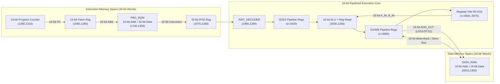

# Processor Architecture Specification

## 1. Academic Context and Project Scope

This document analyzes the architectural design of the **Custom 16-bit Harvard Architecture CPU with a 32-bit Instruction Set**, developed in Logisim Evolution v4.1.0 as an undergraduate computer architecture and digital logic design project within the **B.Sc. (Hons.) Electronics Science** curriculum at **Sri Venkateswara College, University of Delhi**.

All specifications in this document distinguish strictly between:
1. **Handwritten ISA Specifications**: The author's intended instruction encodings and architectural conventions (Sources B and C).
2. **Verified Circuit Implementation**: Hardware structures, bus widths, and component interconnections directly verified from the XML netlist of [`../circuit/CPU_Harvard_Arc.circ`](../circuit/CPU_Harvard_Arc.circ) (Source A).
3. **Simulation-Verified Behavior**: Operational characteristics established by tracing the exact netlist and initial `PRG_ROM` image (`d0000001`, `d1000001`, `10100000`, `c0100001`, `b2000000`, `f0000001`).
4. **Inferred / Unverified Features**: Hardware structures present in the schematic whose runtime behavior is partially disconnected or pending interactive testing.
5. **Proposed Future Improvements**: Architectural enhancements not currently present in `CPU_Harvard_Arc.circ`.

---

## 2. Verified Hardware Specifications

Every width and component parameter below has been confirmed directly from the XML component attributes in `CPU_Harvard_Arc.circ`.

| Architectural Property | Initial Observation | Verified Circuit Value (`CPU_Harvard_Arc.circ`) | Verification Source in Circuit |
| :--- | :--- | :--- | :--- |
| **Memory Organization** | Harvard-style | **Pure Harvard Architecture** (separate `PRG_ROM` and `DATA_RAM` buses) | `PRG_ROM` at `(1730,1300)`, `DATA_RAM` at `(6610,1300)` |
| **Instruction Word Width** | 32 bits | **32 bits** | `PRG_ROM` `dataWidth="32"`, `INST_DECODER` `DATA_IN` `width="32"` |
| **Primary Data Width** | 16 bits | **16 bits** | GPRs `width="16"`, `ALU_OUT` `width="16"`, `DATA_RAM` `dataWidth="16"` |
| **Program Counter Width** | 24 bits | **24 bits** (`max="0xffffff"`) | `Counter` at `(1280,1310)` `width="24"` |
| **Program ROM Address Width** | 24 bits | **24 bits** (16,777,216 word addresses) | `ROM` at `(1730,1300)` `addrWidth="24"` |
| **Program ROM Data Width** | 32 bits | **32 bits** (1 instruction word per address) | `ROM` at `(1730,1300)` `dataWidth="32"` |
| **Data RAM Address Width** | 16 bits | **16 bits** (65,536 word addresses) | `RAM` at `(6610,1300)` `addrWidth="16"` |
| **Data RAM Data Width** | 16 bits | **16 bits** (16-bit word-addressed storage) | `RAM` at `(6610,1300)` `dataWidth="16"` |
| **General-Purpose Registers** | Custom | **16 registers (`R0`–`R15`), 16 bits each** | Two rows of 8 registers at `y=1760` (`R0`–`R7`) and `y=2310` (`R8`–`R15`), `x=4500..5970` |
| **Special / Config Registers** | Custom | **8 registers (`CFG_REG[0..7]`), 16 bits each** | Row at `y=1370`, `x=4500..5970` (`PORT_A_CFG`, `PORT_B_CFG`, `PORT_A_DATA`, `PORT_B_DATA`, `INTERRUPT_CFG`, `CTR_CFG`, `CTR_DATA`, `STACK_POINTER`) |
| **ALU Operand Width** | Apparently 16 bits | **16 bits** (`A_IN[15:0]`, `B_IN[15:0]`) | `ALU` pins `(11670,7360)` and `(11670,7400)` `width="16"` |
| **ALU Result Width** | Apparently 16 bits | **16 bits** primary (`ALU_OUT[15:0]`) + **16 bits** high product (`MUL_OUT_H[15:0]`) | `ALU` pins `(13240,6980)` and `(13240,6240)` `width="16"` |
| **Status Flag Register** | Status flags | **8 bits** (`CARRY_F`, `NEG_F`, `CMP_F`, `V_F`, `ZERO_F`, `H_F`, `T_F`, `INT_F`) | `ALU` internal register `(13000,6730)` + `main` buffer register `(3650,1280)` |
| **Pipeline Structure** | Pipelined | **4-Stage Inter-Stage Pipeline Register Organization** (5 execution phases: IF1, IF2, ID, EX, WB/MEM) | Fetch Reg `(1560,1280)`, IF/ID Reg `(2070,1280)`, ID/EX Bank `(x=2630)`, EX/WB Bank `(x=3980)` |
| **Implementation Tool** | Logisim Evolution | **Logisim Evolution v4.1.0** | XML header `<project source="4.1.0" version="1.0">` |

---

## 3. Distinction Between Architectural Bus and Component Widths

A common source of confusion in custom processor design is conflating instruction word width, address bus width, and datapath processing width. The implemented CPU separates these dimensions cleanly:

1. **Instruction Width (32 bits) vs. Data Processing Width (16 bits)**:
   - Each instruction word fetched from `PRG_ROM` is **32 bits** wide (`DATA_IN[31:0]`).
   - Having a 32-bit instruction word does **not** make this a 32-bit processor. A processor's bit-width classification ("16-bit CPU") is defined by the width of its general-purpose registers (`R0`–`R15`), ALU operands (`A_IN`, `B_IN`), ALU output (`ALU_OUT`), and data memory bus (`DATA_RAM`), all of which are **16 bits**.
   - The 32-bit instruction format is an architectural design choice that eliminates multi-word variable-length instruction fetching: a single 32-bit instruction word can simultaneously encode a 4-bit primary opcode (`[31:28]`), a 4-bit destination register (`[27:24]`), a 4-bit source register (`[23:20]`), a 4-bit subopcode/type field (`[19:16]`), and a full **16-bit immediate constant or memory address** (`[15:0]`) in a single ROM read cycle.

2. **Program ROM Address Width (24 bits) vs. Program ROM Data Width (32 bits)**:
   - The Program Counter (`1280,1310`), Fetch Address Register (`1560,1280`), and `PRG_ROM` address port (`1730,1300`) are **24 bits** wide (`0x000000` to `0xFFFFFF`).
   - Because `PRG_ROM` has `dataWidth="32"`, it is **word-addressed (32-bit instruction words)**, not byte-addressed. Incrementing the Program Counter by `+1` advances to the next 32-bit instruction word.
   - **Addressable Capacity vs. Simulation Allocation**: A 24-bit word address space theoretically spans $2^{24} = 16,777,216$ instruction words ($16	ext{ M}	imes 32	ext{ bits} = 64	ext{ MiB}$ of program memory). In Logisim Evolution, sparse memory allocation is used so that only populated pages consume host RAM; the initial ROM image in `CPU_Harvard_Arc.circ` contains 6 test words at addresses `0x000000`–`0x000005`.

3. **Data RAM Address Width (16 bits) vs. Data RAM Data Width (16 bits)**:
   - `DATA_RAM` (`6610,1300`) is configured with `addrWidth="16"` and `dataWidth="16"`.
   - Every address from `0x0000` to `0xFFFF` selects a full **16-bit data word** (word-addressed memory), providing $2^{16} = 65,536$ words ($128	ext{ KiB}$) of data storage.
   - Because the data address bus is 16 bits wide, the 16-bit `ADD_OUT` field extracted from bits `[15:0]` of a 32-bit `LDS` or `STS` instruction can directly address any location in `DATA_RAM` without base-register offsetting or page segmentation.

4. **Internal Bus Widths**:
   - **Instruction Fetch Bus**: 32 bits from `PRG_ROM` to `INST_DECODER`.
   - **Decoded Register Select Buses (`RD`, `RS`)**: 16-bit one-hot buses exiting `INST_DECODER` and propagating through the ID/EX and EX/WB pipeline registers to control the 16 general-purpose registers (`R0`–`R15`), plus 4-bit encoded index buses generated by Priority Encoders (`6440,2170` and `6440,2360`) to select inputs on the two 16-to-1 ALU operand multiplexers (`6320,2090` and `6320,2270`).
   - **Shared Write-Back & Memory Data Bus**: 16 bits wide (`net (6180,1880)`), shared via tri-state Controlled Buffers across `ALU_OUT`, `LDI` immediate data (`DATA_OUT`), `MOV` source register outputs, `DATA_RAM` write data (`STS1`), and `DATA_RAM` read data (`LDS1`).
   - **Waveform / Debug Observation Buses**: Four 64-bit tunnels (`REG_0_1_2_3`, `REG_4_5_6_7`, `REG_8_9_10_11`, `REG_12_13_14_15`) bundle the 16-bit outputs of `R0`–`R15` in groups of four via 64-bit Splitters (`6150,2400` to `6270,2400`).

---

## 4. Harvard vs. Von Neumann vs. Modified Harvard Classification

### Architectural Definitions
- **Von Neumann Architecture**: Uses a single shared memory space and a single shared address/data bus for both program instructions and program data. The CPU cannot fetch an instruction from memory and read/write data memory over the same bus at the same instant (the Von Neumann bottleneck).
- **Strict (Pure) Harvard Architecture**: Uses physically separate memory modules (`PRG_ROM` and `DATA_RAM`) with completely independent address and data buses for instructions and data. Instruction memory and data memory can have different word widths and different address widths, and an instruction fetch in Stage 1/2 does not contend with a `DATA_RAM` access in Stage 5.
- **Modified Harvard Architecture**: Uses separate instruction and data caches or buses at the core boundary, but backs them with a unified main address space (or provides instructions such as `LPM` on AVR to read program memory as data).

### Classification of This Processor
Based on the verified `CPU_Harvard_Arc.circ` netlist, this processor implements a **Pure (Strict) Harvard Architecture**:
1. **Physically Separate Memories with Asymmetric Widths**: `PRG_ROM` (`1730,1300`) is a 24-bit-addressed, 32-bit-wide read-only instruction store, whereas `DATA_RAM` (`6610,1300`) is a 16-bit-addressed, 16-bit-wide read/write data store.
2. **Zero Bus Sharing Between Instruction Fetch and Data Access**: The 24-bit PC bus (`1520,1310`) and 32-bit instruction bus (`2070,1310`) have no electrical connection to the 16-bit `DATA_RAM` address bus (`6610,1310`) or 16-bit `DATA_RAM` data ports (`6610,1390`, `6850,1390`).
3. **Concurrent Fetch and Data Access Capability**: Because the processor is pipelined and uses independent buses for `PRG_ROM` (Stage 1/2) and `DATA_RAM` (Stage 5), `PRG_ROM` continuously fetches a 32-bit instruction every clock cycle while an older `LDS` or `STS` instruction in Stage 5 accesses `DATA_RAM` simultaneously without structural bus hazards.
4. **No Self-Modifying Code or Program-Space Data Loads**: There is no datapath route to write into `PRG_ROM` or read `PRG_ROM` words into general-purpose registers `R0`–`R15`.

