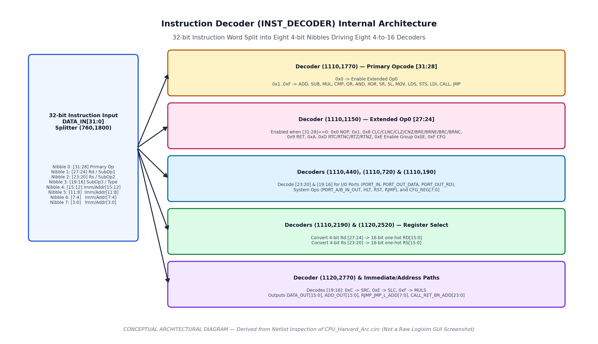

# Control Unit and Instruction Decoder (`INST_DECODER`)

## 1. Hardwired Combinational Control Classification

Inspection of [`../circuit/CPU_Harvard_Arc.circ`](../circuit/CPU_Harvard_Arc.circ) confirms that the processor uses a **hardwired combinational control unit** (`INST_DECODER` at `2480,1290`) paired with **pipelined control registers** in `main` (`x=2630` and `x=3980`). There is no microprogram ROM, microsequencer, or finite-state machine (FSM) multi-cycle controller; instead, decoded instruction signals propagate alongside data operands through the pipeline stage registers.

*Figure 1: Internal organization of the `INST_DECODER` subcircuit (`90` components, `449` wires).*

---

## 2. Internal Structure of `INST_DECODER`

The `INST_DECODER` subcircuit accepts two inputs:
1. **`DATA_IN[31:0]`** (`710,1800`): The 32-bit instruction word from IF/ID Register `(2070,1280)`.
2. **`FLAGS_IN[7:0]`** (`700,1620`): The 8-bit status flags from Register `(3650,1280)`.

### 2.1 The Eight 4-to-16 Decoders in `INST_DECODER`

| Decoder Instance | Select Input (`4 bits`) | Enable (`en`) Condition | Active Outputs & Function |
| :--- | :--- | :--- | :--- |
| **`Decoder (1110,1770)`** | `DATA_IN[31:28]` (Nibble 0) | `Constant 0x1` (`1060,1790`, always enabled) | **Primary Opcode Decoder**: `0x0` -> Enables `Decoder (1110,1150)` `0x1` -> `ADD` \| `0x2` -> `SUB` \| `0x3` -> `MUL` \| `0x4` -> `CMP` `0x5` -> `O_R` \| `0x6` -> `A_ND` \| `0x7` -> `X_OR` `0x8` -> `SR` \| `0x9` -> `SL` \| `0xA` -> `MOV` `0xB` -> `LDS` \| `0xC` -> `STS` \| `0xD` -> `LDI` `0xE` -> `CALL` \| `0xF` -> `JMP` |
| **`Decoder (1110,1150)`** | `DATA_IN[27:24]` (Nibble 1) | `Decoder(1110,1770).OUT[0]` (`[31:28] == 0000`) | **Extended Opcode `0x0` Decoder**: `0x0` -> `NOP` `0x1..0x8` -> Conditional Calls/Branches (`CLC`, `CLNC`, `CLZ`, `CNZ`, `BRE`, `BRNE`, `BRC`, `BRNC`) via 8 AND gates `0x9` -> `RET` `0xA..0xD` -> Conditional Returns (`RTC`, `RTNC`, `RTZ`, `RTNZ`) via 4 AND gates `0xE` -> Enables `Decoder (1110,440)` `0xF` -> Asserts `CFG` and enables `Decoder (1110,720)` |
| **`Decoder (1110,440)`** | `DATA_IN[23:20]` (Nibble 2) | `Decoder(1110,1150).OUT[14]` (`[31:24] == 0x0E`) | **I/O & System Group Decoder**: `0x0` -> `PORT_IN` `0x1` -> `PORT_OUT_DATA` `0x2` -> `PORT_OUT_RD` *(OR gate `1320,430` combines outputs `0..2` to enable `Decoder (1110,190)`)* |
| **`Decoder (1110,190)`** | `DATA_IN[19:16]` (Nibble 3) | `PORT_IN \| PORT_OUT_DATA \| PORT_OUT_RD` | **System & Port Subtype Decoder**: `0x0` -> `PORT_A_IN_OUT` `0x1` -> `PORT_B_IN_OUT` `0x2` -> `HLT` `0x3` -> `RST` `0x4` -> `RJMP` |
| **`Decoder (1110,720)`** | `DATA_IN[23:20]` (Nibble 2) | `CFG` (`[31:24] == 0x0F`) | **Configuration Register Select Decoder**: Outputs `0..7` drive `CFG_REG[7:0]` (`1890,550`) to select one of the 8 special registers at `y=1370`. |
| **`Decoder (1110,2190)`** | `DATA_IN[27:24]` (Nibble 1) | `OR Gate (1570,1830)` (`ADD`, `SUB`, `MUL`, `CMP`, `O_R`, `A_ND`, `X_OR`, `SR`, `SL`, `MOV`, `LDS`, `LDI`, `PORT_OUT_RD`) | **Destination Register (`RD`) Decoder**: Outputs `0..15` drive the 16-bit one-hot `RD[15:0]` bus (`1890,2020`). |
| **`Decoder (1120,2520)`** | `DATA_IN[23:20]` (Nibble 2) | `OR Gate (1450,1830)` (`ADD`, `SUB`, `MUL`, `CMP`, `O_R`, `A_ND`, `X_OR`, `SR`, `SL`, `MOV`, `STS`, `PORT_OUT_RD`) | **Source Register (`RS`) Decoder**: Outputs `0..15` drive the 16-bit one-hot `RS[15:0]` bus (`1890,2350`). |
| **`Decoder (1120,2770)`** | `DATA_IN[19:16]` (Nibble 3) | `OR Gate (1370,1830)` (`JMP`, `MUL`, `SR`, `SL`, `ADD`, `SUB`, `CMP`, `STS`) | **ALU Operation Subtype Decoder**: `0xC` (`1100`) -> `SRC` `0xE` (`1110`) -> `SLC` `0xF` (`1111`) -> `MULS` |

---

## 3. Complete Control Signal Reference Table

| Control Signal / Tunnel | Source Component | Width | Active Condition | Datapath Effect in `main` and `ALU` |
| :--- | :--- | :---: | :--- | :--- |
| **`ADD`, `SUB`, `MUL`, `CMP`, `O_R`, `A_ND`, `X_OR`, `SR`, `SL`** | `INST_DECODER` -> Reg `(2630,1750)` -> Splitter `(2980,1650)` | 9x 1 bit | Primary opcode `[31:28]` in `0x1..0x9` | Select the active operation in `ALU` and assert `ALU_EN` / `FLAG_WR` via OR gate `(3190,1740)`. |
| **`SRC`, `SLC`, `MULS`** | `INST_DECODER` -> Reg `(2630,1860)` -> Splitter `(2980,1250)` | 3x 1 bit | `[19:16]` = `0xC` (`SRC`), `0xE` (`SLC`), or `0xF` (`MULS`) | Modify ALU operation (`SRC` asserts `SFT_W_CRY`; `MULS` asserts `MUL_MULS` high-word write). |
| **`MUL_MULS`** | `OR Gate (3200,1310)` (`MUL \| MULS`) | 1 bit | `MUL` (`0x3`) or `MULS` (`0x3..F`) in Stage 3 | Latched into Reg `(3980,1750)` bit 5; in Stage 5, enables `MUL_OUT_H` into `R0` and asserts write-enable on `R1` and `R0`. |
| **`MOV`** | `INST_DECODER` -> Reg `(2630,1750)` -> `Tunnel: MOV` | 1 bit | Primary opcode `[31:28] == 1010` (`0xA`) | Asserts `RD` and `RS` latch enables in Stage 3 so `Rs` drives the WB bus and `Rd` latches it in Stage 5. |
| **`LDI`** | `INST_DECODER` -> Reg `(2630,2080)` -> `Tunnel: LDI` | 1 bit | Primary opcode `[31:28] == 1101` (`0xD`) | Enables `RD` buffer `(3780,1580)` in Stage 3; latched into Reg `(3980,1750)` bit 2 to enable `DATA_OUT` Buffer `(4350,1880)` onto WB bus in Stage 5. |
| **`LDS` / `LDS1`** | `INST_DECODER` -> Reg `(2630,1750)` -> `Tunnel: LDS` -> Reg `(3980,1750)` -> `Tunnel: LDS1` | 1 bit | Primary opcode `[31:28] == 1011` (`0xB`) | Enables `RD` buffer `(3780,1630)` in Stage 3; in Stage 5 (`LDS1`), enables `ADD_OUT` to `DATA_RAM`, asserts `DATA_RAM` output enable, and enables Buffer `(6180,1880)` onto WB bus. |
| **`STS` / `STS1`** | `INST_DECODER` -> Reg `(2630,1750)` -> `Tunnel: STS` -> Reg `(3980,1750)` -> `Tunnel: STS1` | 1 bit | Primary opcode `[31:28] == 1100` (`0xC`) | Enables `RS` buffer `(3780,2070)` in Stage 3; in Stage 5 (`STS1`), enables `Rs` onto WB bus, enables Buffer `(6170,1850)` into `DATA_RAM.D`, enables `ADD_OUT` to `DATA_RAM.A`, and asserts `DATA_RAM.WE`. |
| **`CFG`** | `INST_DECODER` -> Reg `(2630,1750)` -> `Tunnel: CFG` -> Reg `(3980,1750)` | 1 bit | `[31:24] == 0x0F` | In Stage 5, enables Buffer `(4320,1400)` to route 16-bit `DATA_OUT` into the selected special register `CFG_REG[Rs]`. |
| **`JMP`** | `INST_DECODER` -> Reg `(2630,2080)` -> `Tunnel: JMP` | 1 bit | Primary opcode `[31:28] == 1111` (`0xF`) | Enables 24-bit jump target Buffer `(2870,2660)` into Reg `(2630,2640)` and asserts `CTR_STP1` via OR gate `(2790,2460)`. |
| **`CALL_RET_BRN`** | `INST_DECODER` -> Reg `(2630,1630)` -> Splitter `(2780,1480)` | 14 bits | Any of `RJMP`, `CLC`, `CLNC`, `CLZ`, `CNZ`, `BRE`, `BRNE`, `BRC`, `BRNC`, `RET`, `RTC`, `RTNC`, `RTZ`, `RTNZ` | Combined with `CALL` (`3050,2430`) in 14-input OR gate `(2930,2540)` to enable 24-bit `CALL_RET_ADD` Buffer `(2900,2630)` and assert `CTR_STP1`. |
| **`CTR_STP1`** | `OR Gate (2790,2460)` -> Reg `(2630,2450)` bit 3 -> `Tunnel: CTR_STP1` | 1 bit | `HLT \| JMP \| CALL \| RET \| Branch` in Stage 3 | Latched into Reg `(2630,2450)` bit 3 (`2750,2430`). Inverts `PC.en` via `(1410,1160)` and asserts `DFR_RST1`/`DFR_RST2` via `(2820,2780)` to flush IF1 & IF2 registers. |
| **`HLT`** | `INST_DECODER` -> Reg `(2630,1250)` -> `Tunnel: HLT` -> Reg `(2630,2450)` bit 1 | 1 bit | `[31:16] == 0x0E02` (`0x0E12`, `0x0E22`) | Latched into Reg `(2630,2450)` bit 1 (`970,1170`), which switches Clock Multiplexer `(1270,1070)` select pin to `1`, replacing `CLK` with `Constant 0x0` (`1210,1080`) and halting the entire CPU. |
| **`RST` / `RST_MAIN`** | `INST_DECODER` -> Reg `(2630,1250)` -> `Tunnel: RST` -> Reg `(2630,2450)` bit 0 | 1 bit | `[31:16] == 0x0E03` | Latched into Reg `(2630,2450)` bit 0 (`970,1160`), asserting `RST_MAIN` and `DFR_RST` to clear all registers and PC to `0`. |
