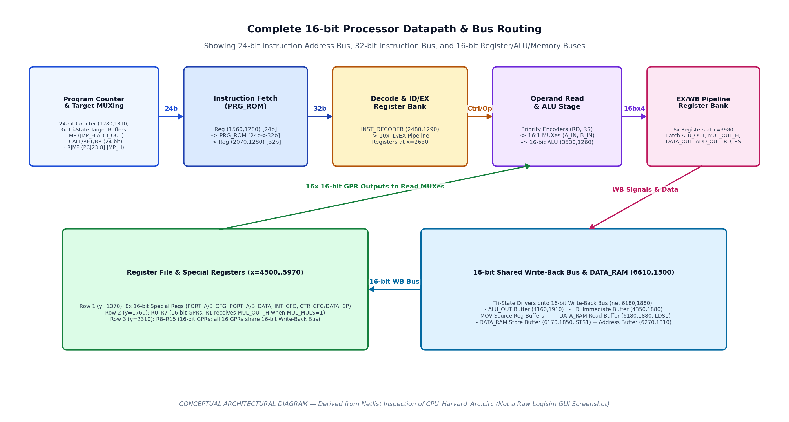
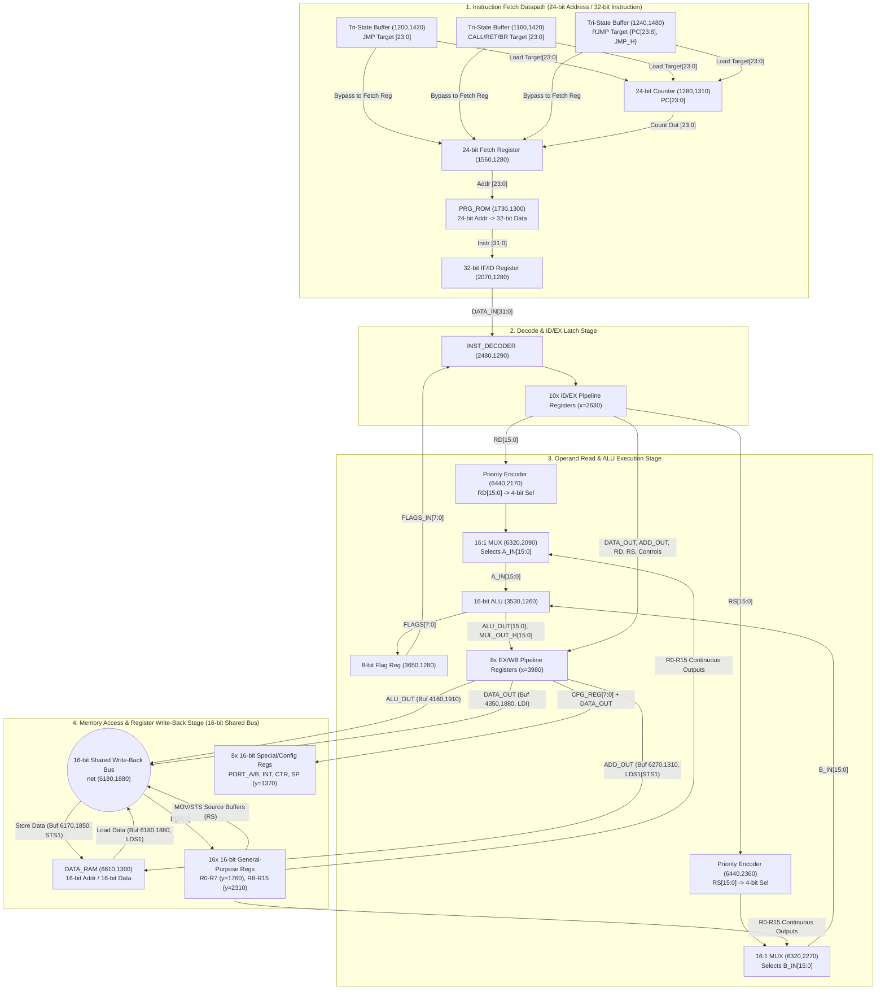

# Processor Datapath Organization

## 1. Datapath Overview

The `main` circuit in [`../circuit/CPU_Harvard_Arc.circ`](../circuit/CPU_Harvard_Arc.circ) implements a 16-bit register-transfer datapath with a 24-bit instruction fetch path, a 32-bit instruction decode path, and a tri-state 16-bit write-back/memory bus.

*Figure 1: Conceptual datapath diagram traced from `main` in `CPU_Harvard_Arc.circ`.*

---

## 2. Component-by-Component Datapath Specification

### 2.1 Program Counter and Target Address Multiplexing
- **Program Counter (`1280,1310`)**:
  - **Component Type**: Logisim Evolution 24-bit `Counter` (`width="24"`, `max="0xffffff"`).
  - **Inputs**:
    - `clk` (`1280,1390`): Driven by `Tunnel: CLK`.
    - `clr` (`1280,1330`): Driven by `RST_MAIN` (`5970,1440`).
    - `load` (`1280,1340`): Driven by `OR Gate (1120,1280)`, which asserts when either `JMP | CALL | RET | Branch` (`net 2770,2800`) or `RJMP` (`net 1230,1490`) is active in Stage 3.
    - `dir` (`1280,1360`): Tied to `Constant 0x1` (`1260,1360` = count up).
    - `en` (`1280,1380`): Driven by `NOT Gate (1410,1160)` inverting `CTR_STP1` (`~CTR_STP1`). Note that the counter's 24-bit output port is also connected to `(1420,1210)` on this net.
    - `D[23:0]` (`1280,1420`): 24-bit parallel load bus driven by three tri-state Controlled Buffers:
      1. **Buffer `(1160,1420)`**: Enabled by `CALL | RET | Branch` (`1150,1410`), driving the 24-bit target latched in Register `(2630,2640)`.
      2. **Buffer `(1200,1420)`**: Enabled by `~(RJMP)` (`1190,1410`), passing the output of `(1160,1420)` to `PC.D[23:0]` and onto wire `(1520,1310)` feeding the Fetch Address Register `(1560,1280)`.
      3. **Buffer `(1240,1480)`**: Enabled by `RJMP` (`1230,1490`), driving `{Upper 16 bits, JMP_H[7:0]}` from Splitter `(1220,1610)` onto `PC.D[23:0]`.

### 2.2 Instruction Memory Interface and IF/ID Latch
- **Fetch Address Register (`1560,1280`)**:
  - **Width**: 24 bits.
  - **Input `D[23:0]` (`1560,1310`)**: Connected to net `(1520,1930)`, which is joined to both the 24-bit target load bus (`1500,1420`) and Splitter `(1420,1930)`.
  - **Enable (`1560,1330`) & Clock (`1560,1350`)**: Both pins are connected to `Tunnel: CLK` (`6610,1370`).
  - **Reset (`1590,1370`)**: Driven by 3-input OR gate `(1590,1400)` (`RST_MAIN | DFR_RST | DFR_RST1`), which flushes the fetched address to `0x000000` on reset or any taken branch/jump (`DFR_RST1`).
- **Program ROM (`PRG_ROM` at `1730,1300`)**:
  - **Address Input (`1730,1310`)**: 24 bits from Fetch Register `(1560,1280)`.
  - **Data Output (`1970,1360`)**: 32 bits (`DATA_IN[31:0]`).
- **Instruction Register / IF-ID Pipeline Register (`2070,1280`)**:
  - **Width**: 32 bits.
  - **Input `D[31:0]` (`2070,1310`)**: 32-bit instruction word from `PRG_ROM`.
  - **Enable & Clock**: Connected to `Tunnel: CLK`.
  - **Reset (`2100,1370`)**: Driven by 3-input OR gate `(2100,1400)` (`RST_MAIN | DFR_RST | DFR_RST2`), flushing the instruction register to `0x00000000` (`NOP`) on any taken branch/jump.

### 2.3 Register File Organization (`R0`–`R15` and Special Registers)
Instead of a monolithic memory block, the register file is constructed from **24 discrete 16-bit Logisim Register components** arranged in an $8 	imes 3$ matrix across `x = 4500, 4710, 4930, 5140, 5340, 5550, 5760, 5970`:

| Row Y-Coordinate | Register Names / Roles | Data Input (`D[15:0]`) | Write Enable (`en`) Source | Output Routing |
| :---: | :--- | :--- | :--- | :--- |
| **Row 1 (`y = 1370`)** | **8 Special / Config Registers**: 0: `PORT_A_CFG` (`4500,1370`) 1: `PORT_B_CFG` (`4710,1370`) 2: `PORT_A_DATA` (`4930,1370`) 3: `PORT_B_DATA` (`5140,1370`) 4: `INTERRUPT_CFG` (`5340,1370`) 5: `CTR_CFG` (`5550,1370`) 6: `CTR_DATA` (`5760,1370`) 7: `STACK_POINTER` (`5970,1370`) | Net `(5970,1400)`, driven by `DATA_OUT` via Buffer `(4320,1400)` when `CFG=1`, or by the WB bus via Buffer `(4430,1510)` when `CFG_RD=1`. | Latched `CFG_REG[7:0]` from Reg `(3980,1280)` via bit-reversed Splitter `(4340,1310)`. | Routed to 16-bit observation tunnels (`PORT_A_CFG`, ..., `STACK_POINTER`). |
| **Row 2 (`y = 1760`)** | **General-Purpose Registers `R0`–`R7`**: `R0` (`4500,1760`) through `R7` (`5970,1760`) | Shared 16-bit Write-Back Bus (`net 6180,1880`), except `R0` which has Buffer `(4480,1790)` from WB Bus and Buffer `(4490,1770)` from `MUL_OUT_H`. | Latched `RD[7:0]` from Reg `(3980,1640)` via Splitters `(4180,1670)` and `(4310,1680)`. `R1` (`4710,1760`) also ORs `MUL_MULS` via `(4700,1730)`. | Continuous feeds to 16:1 Read MUXes `(6320,2090)` & `(6320,2270)`, 64-bit debug tunnels, and tri-state buffers onto WB Bus (controlled by `RS[7:0]`). |
| **Row 3 (`y = 2310`)** | **General-Purpose Registers `R8`–`R15`**: `R8` (`4500,2310`) through `R15` (`5970,2310`) | Shared 16-bit Write-Back Bus (`net 6180,1880`). | Latched `RD[15:8]` from Reg `(3980,1640)` via Splitters `(4180,1670)` and `(4310,2150)`. | Continuous feeds to 16:1 Read MUXes `(6320,2090)` & `(6320,2270)`, 64-bit debug tunnels, and tri-state buffers onto WB Bus (controlled by `RS[15:8]`). |

### 2.4 ALU Operand Selection Multiplexers (`6320,2090` and `6320,2270`)
- All 16 general-purpose registers (`R0`–`R15`) continuously wire their 16-bit `Q` outputs to inputs `0..15` of two 16-to-1 Multiplexers:
  - **MUX `(6320,2090)`**: Outputs 16-bit **`A_IN`** (`Rd` value). Its 4-bit select input (`6300,2170`) is driven by 16-to-4 **Priority Encoder `(6440,2170)`**, which encodes the 16-bit one-hot `Tunnel: RD` bus (via bit-reversing Splitter `6500,2260`).
  - **MUX `(6320,2270)`**: Outputs 16-bit **`B_IN`** (`Rs` value). Its 4-bit select input (`6300,2350`) is driven by 16-to-4 **Priority Encoder `(6440,2360)`**, which encodes the 16-bit one-hot `Tunnel: RS` bus (via Splitter `6500,2280`).
- **Bit-Order Detail on `RD` and `RS` Priority Encoders**:
  - In `INST_DECODER`, `RD` (`1890,2020`) and `RS` (`1890,2350`) are packed by default `facing="west"` Splitters where `DEC.OUT[0]` (`R0`) is at the top (`bit0`) and `DEC.OUT[15]` (`R15`) is at the bottom (`bit15`).
  - At the Priority Encoders `(6440,2170)` and `(6440,2360)`:
    - Splitter `(6500,2260)` on `RD` has `appear="right", facing="west"`, whereas Splitter `(4180,1670)` / `(4310,1680)` in the write-back stage reverses the bit order (`bit0="7"..bit7="0"`) for `R0`–`R7` (`4500,1760` to `5970,1760`) and `R8`–`R15` (`4500,2310` to `5970,2310`).
    - Specifically, in Stage 5 write-back, Splitter `(4180,1670)` routes `RD[7:0]` (`R0`–`R7`) to `(4310,1680)` (which maps `bit0` (`R0`) to the bottom wire `y=1670`, driving `R0` at `4500,1760`, and `bit7` (`R7`) to the top wire `y=1600`, driving `R7` at `5970,1760`). Meanwhile, for `RS` (`4220,2010` -> `4310,2010`), `(4310,2010)` does **not** reverse bits `0..7`, so `RS` bit 0 (`R0`) drives the top wire (`R0` buffer at `4600,1790`) and `RS` bit 7 (`R7`) drives the bottom wire (`R7` buffer at `6070,1790`). Thus, both `RD` and `RS` consistently map index `0` to `R0` (`4500,1760`) and index `7` to `R7` (`5970,1760`)!

### 2.5 Shared 16-bit Write-Back Bus (`net (6180,1880)`)
The processor uses a single 16-bit tri-state bus (`net (6180,1880)`) in Stage 5 to route data into `R0`–`R15` and `DATA_RAM`. Nineteen tri-state Controlled Buffers can drive this bus:
1. **ALU Result Buffer `(4160,1910)`**: Drives `ALU_OUT[15:0]` from Reg `(3980,1860)` onto the WB bus when `bit 6` of the 7-bit EX/WB control register `(3980,1750)` is `1` (active for `ADD`, `SUB`, `MUL`, `CMP`, `OR`, `AND`, `XOR`, `SR`, `SL`).
2. **Immediate (`LDI`) Buffer `(4350,1880)`**: Drives 16-bit `DATA_OUT` from Reg `(3980,1400)` onto the WB bus when `LDI` (`bit 2` of Reg `3980,1750`) is `1`.
3. **Data RAM Read (`LDS`) Buffer `(6180,1880)`**: Drives the 16-bit data read from `DATA_RAM` (`6850,1390`) onto the WB bus when `LDS1` (`bit 3` of Reg `3980,1750`) is `1`.
4. **16 Register Source Buffers (`4600,1790`..`6070,1790` and `4600,2340`..`6070,2340`)**: Drive the 16-bit content of source register `Rs` onto the WB bus when enabled by Reg `(3980,1970)` (active during `MOV` and `STS`).
5. **Pull Resistor `(4450,1920)`**: Weakly pulls the 16-bit WB bus to `0x0000` when no tri-state driver is active.
