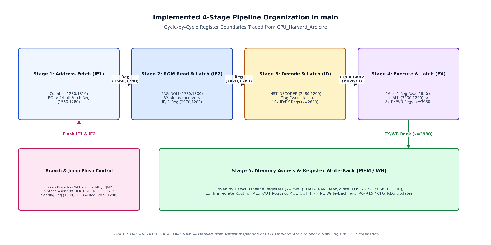

# Pipeline Organization and Hazard Analysis

## 1. Verified Pipeline Structure in `CPU_Harvard_Arc.circ`

Although classical RISC textbooks describe a 5-stage (`IF`, `ID`, `EX`, `MEM`, `WB`) pipeline, direct inspection of [`../circuit/CPU_Harvard_Arc.circ`](../circuit/CPU_Harvard_Arc.circ) establishes that this processor implements **four clocked inter-stage pipeline register boundaries** dividing instruction execution into **five sequential clock phases** (`IF1`, `IF2`, `ID`, `EX`, and a combined `MEM/WB` phase):

*Figure 1: Verified pipeline register boundaries in `main`.*

| Pipeline Boundary | Logisim Register Component(s) in `main` | Total Latched Width | Signals Latched Across Boundary | Clear / Flush Signal |
| :--- | :--- | :---: | :--- | :--- |
| **Boundary 1 (`IF1 / IF2`)** | **Fetch Address Register** at `(1560,1280)` | 24 bits | 24-bit Program Counter address (`PC[23:0]`) feeding `PRG_ROM` | `RST_MAIN \| DFR_RST \| DFR_RST1` (OR gate `1590,1400`) |
| **Boundary 2 (`IF2 / ID`)** | **Instruction Register (`IR`)** at `(2070,1280)` | 32 bits | 32-bit instruction word (`DATA_IN[31:0]`) fetched from `PRG_ROM` | `RST_MAIN \| DFR_RST \| DFR_RST2` (OR gate `2100,1400`) |
| **Boundary 3 (`ID / EX`)** | **8 Pipeline Registers** stacked vertically at `x = 2630`: 1. `(2630,1250)` [8b] 2. `(2630,1390)` [8b] 3. `(2630,1510)` [24b] 4. `(2630,1630)` [30b] 5. `(2630,1750)` [32b] 6. `(2630,1860)` [3b] 7. `(2630,1970)` [8b] 8. `(2630,2080)` [32b] *(Plus 2 Branch Feedback Regs `(2630,2450)` [4b] & `(2630,2640)` [24b])* | 145 bits (+ 28 bits branch feedback) | 1. System/Port ops (`HLT`, `RST`, `NOP`, etc.) 2. `CFG_REG[7:0]` 3. `CALL_RET_ADD[23:0]` 4. `RJMP`, `CLC`..`RTNZ` (`CALL_RET_BRN`) 5. `CFG`, `ADD`..`STS`, `RD[15:0]` 6. `SRC`, `SLC`, `MULS` 7. `RJMP_JMP_L_ADD[7:0]` (`JMP_H`) 8. `RS[15:0]`, `DATA_OUT[15:0]`, `ADD_OUT[15:0]` | `RST_MAIN \| DFR_RST` (OR gate `2660,2210`) |
| **Boundary 4 (`EX / WB`)** | **8 Pipeline Registers** stacked vertically at `x = 3980`: 1. `(3980,1280)` [8b] 2. `(3980,1400)` [16b] 3. `(3980,1520)` [16b] 4. `(3980,1640)` [16b] 5. `(3980,1750)` [7b] 6. `(3980,1860)` [16b] 7. `(3980,1970)` [16b] 8. `(3980,2080)` [16b] *(Plus Flag Buffer Reg `(3650,1280)` [8b])* | 111 bits (+ 8 bits flags) | 1. `CFG_REG[7:0]` 2. `DATA_OUT[15:0]` (LDI / CFG immediate) 3. `MUL_OUT_H[15:0]` (High product) 4. Gated `RD[15:0]` write-enable mask 5. `{ALU_WB, MUL_MULS, STS, LDS, LDI, CFG, CFG_RD}` 6. `ALU_OUT[15:0]` 7. Gated `RS[15:0]` read-enable mask 8. `ADD_OUT[15:0]` (RAM address) | `RST_MAIN \| DFR_RST` (OR gate `4060,2200`) |

---

## 2. Cycle-by-Cycle Execution Overlap

Because all pipeline registers (`1560,1280`, `2070,1280`, `x=2630`, `x=3980`) and destination registers (`R0`–`R15`, `DATA_RAM`) are clocked by the shared global clock `Tunnel: CLK`, an instruction progresses through five clock edges:

```mermaid
gantt
    title Five-Phase Execution Timeline Across Pipeline Registers
    dateFormat X
    axisFormat Cycle %s
    section Instr i (LDI R0, 1)
    IF1 (Latch PC in 1560,1280)       :0, 1
    IF2 (Read ROM -> Latch 2070,1280) :1, 2
    ID  (Decode -> Latch x=2630)      :2, 3
    EX  (Route Imm -> Latch x=3980)   :3, 4
    WB  (Write R0 at 4500,1760)       :4, 5
    section Instr i+1 (LDI R1, 1)
    IF1 (Latch PC)                    :1, 2
    IF2 (Read ROM)                    :2, 3
    ID  (Decode)                      :3, 4
    EX  (Route Imm)                   :4, 5
    WB  (Write R1 at 4710,1760)       :5, 6
    section Instr i+2 (ADD R0, R1)
    IF1 (Latch PC)                    :2, 3
    IF2 (Read ROM)                    :3, 4
    ID  (Decode)                      :4, 5
    EX  (Read R0/R1 & ALU Add)        :5, 6
    WB  (Write R0)                    :6, 7
```

---

## 3. Hazard Analysis: Implemented Mechanisms vs. Unimplemented Features

### 3.1 Structural Hazards
- **Memory Access (Eliminated by Harvard Architecture)**: Because `PRG_ROM` (`1730,1300`) and `DATA_RAM` (`6610,1300`) use completely independent address and data buses, an instruction fetch in `IF2` and a data load/store (`LDS`/`STS`) in `MEM/WB` never contend for the same memory port.
- **Write-Back Bus Sharing**: In Stage 5 (`MEM/WB`), `ALU_OUT`, `LDI` (`DATA_OUT`), `LDS` (`DATA_RAM` out), and `MOV`/`STS` (`Rs` out) share the 16-bit write-back bus (`net 6180,1880`) via mutually exclusive tri-state Controlled Buffers. Because only one instruction occupies Stage 5 in any given clock cycle, different instructions do not collide on the WB bus (with the exception of `MUL R0, Rs`, where `MUL_OUT_H` and `ALU_OUT` both drive `R0.D`).

### 3.2 Data Hazards (Read-After-Write / RAW)
- **Absence of Hardware Data Forwarding or Hazard Stalling**:
  - Netlist inspection confirms that the inputs to the 16-to-1 ALU operand multiplexers (`6320,2090` and `6320,2270`) come **exclusively** from the `Q` outputs of the 16 architectural registers `R0`–`R15`.
  - There are **no forwarding multiplexers** routing `ALU_OUT` from Stage 4 (`3980,1860`) or the Stage 5 write-back bus (`6180,1880`) back to `A_IN` or `B_IN`.
  - Likewise, there is **no hazard detection unit** comparing `RD` in Stage 4/5 against `RD`/`RS` in Stage 3 to stall the pipeline.
- **RAW Hazard Window (2 Clock Cycles)**:
  - An instruction $I_1$ updates its destination register `Rd` on the rising clock edge at the **end of Stage 5 (`WB`)**.
  - A dependent instruction $I_2$ reads `Rd` or `Rs` through the 16-to-1 multiplexers during **Stage 4 (`EX`)** and latches `ALU_OUT` at the **end of Stage 4**.
  - Therefore, if $I_2$ immediately follows $I_1$ (distance = 1 instruction, e.g., `LDI R1, 1` at `0x000001` followed immediately by `ADD R0, R1` at `0x000002`), $I_2$ is in Stage 4 (`EX`) during the exact same clock cycle that $I_1$ is in Stage 5 (`WB`). During that cycle, $I_1$'s new value is sitting on the input `D` of `R1`, waiting for the next rising clock edge to be latched into `R1.Q`! Meanwhile, $I_2$ reads the **old** `R1.Q` value unless two independent instructions (or two `NOP`s) separate $I_1$ and $I_2$.
  - **Example in Pre-loaded `PRG_ROM`**:
    - `0x000000`: `d0000001` (`LDI R0, 1`) — reaches `WB` in Cycle 5 (writes `R0 <= 1` at end of Cycle 5).
    - `0x000001`: `d1000001` (`LDI R1, 1`) — reaches `WB` in Cycle 6 (writes `R1 <= 1` at end of Cycle 6).
    - `0x000002`: `10100000` (`ADD R0, R1`) — reaches `EX` in Cycle 6. During Cycle 6, `R0` has already been updated to `1` (at the end of Cycle 5), so `A_IN = 1`, but `R1` is still in `WB` waiting for the end-of-Cycle-6 clock edge, so `B_IN` still reads `0` (`R0 + R1 = 1 + 0 = 1`) on the first pass! On the second pass (after `JMP 0x000001`), both `R0` and `R1` hold `1`, so `ADD R0, R1` computes `1 + 1 = 2`.

### 3.3 Control Hazards and Implemented Pipeline Flushing
- **Implemented Hardware Flush (`DFR_RST1` and `DFR_RST2`)**:
  - Unlike data hazards, the circuit **does** implement hardware pipeline flushing for control-flow instructions (`JMP`, `CALL`, `RET`, `RJMP`, and conditional branches/calls/returns).
  - When a branch or jump reaches Stage 3 (`ID/EX` outputs), OR gate `(2790,2460)` asserts `CTR_STP1`, and the 24-bit target address is latched into Feedback Register `(2630,2640)` while the 4-bit control word (`{CTR_STP1, RJMP, HLT, RST}`) is latched into Feedback Register `(2630,2450)`.
  - In the following cycle:
    1. `CTR_STP1` drives OR gate `(2820,2780)`, asserting **`DFR_RST1`** and **`DFR_RST2`**.
    2. `DFR_RST1` asynchronously clears Fetch Address Register `(1560,1280)` (`IF1/IF2`) via OR gate `(1590,1400)`.
    3. `DFR_RST2` asynchronously clears Instruction Register `(2070,1280)` (`IF2/ID`) via OR gate `(2100,1400)`, converting the wrong-path instruction into `0x00000000` (`NOP`).
    4. Simultaneously, the 24-bit target address from `(2630,2640)` is loaded into the Program Counter `(1280,1310)` and driven onto the input of Fetch Register `(1560,1280)`.
- **Flag Dependency Latency for Conditional Branches**:
  - Conditional branches (`BRE`, `BRNE`, `BRC`, `BRNC`), calls (`CLC`..`CNZ`), and returns (`RTC`..`RTNZ`) evaluate `FLAGS_IN[7:0]` inside `INST_DECODER` during **Stage 3 (`ID`)**.
  - However, an ALU/CMP instruction updates the `ALU` flag register `(13000,6730)` at the end of **Stage 4 (`EX`)** and latches `Tunnel: FLAGS` in Register `(3650,1280)` at the end of **Stage 5 (`WB`)**.
  - Therefore, a conditional branch must be separated from the flag-setting `CMP` or `ADD` instruction by **2 `NOP` (or independent) instructions** so that the updated `FLAGS` tunnel is stable when the branch enters `INST_DECODER`.
